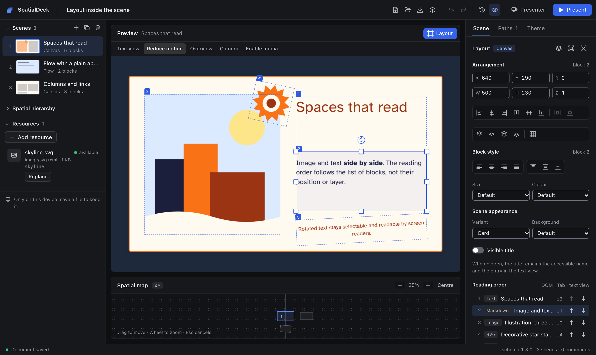

<p align="center">
  <picture>
    <source media="(prefers-color-scheme: dark)" srcset="docs/assets/logo-dark.svg">
    
  </picture>
</p>

<p align="center">
  <b>Spatial, non-linear presentations for the web.</b><br>
  Place scenes in 3D space, branch the story, present offline. No account, no backend, no lock-in.
</p>

<p align="center">
  <a href="https://github.com/fv-c/SpatialDeck/actions/workflows/ci.yml"></a>
  <a href="LICENSE"></a>
  
  
  
</p>

<p align="center">
  <a href="docs/AUTHORING.md">Author guide</a> ·
  <a href="docs/DEVELOPMENT.md">API</a> ·
  <a href="docs/DISTRIBUTION.md">Export &amp; presenter</a> ·
  <a href="docs/PLUGINS.md">Plugins</a> ·
  <a href="docs/ROADMAP.md">Roadmap</a>
</p>

<p align="center">
  
</p>

SpatialDeck is a local-first platform for presentations that live in space rather than on a stack of slides. Scenes are rectangles you position, rotate, scale and nest in a 3D world; a camera flies between them along the paths you design, including branches, choices and limited loops. The same JSON document drives a **framework-free player** you can embed in any page and **Studio**, a visual editor that runs entirely in your browser.

## ✨ Features

- 🌌 **[Scenes in space](docs/AUTHORING.md#scenes-and-space)** — position, rotate and scale scenes in CSS 3D, nest them up to 32 levels deep and reparent them without moving them in the world.
- 🔀 **[Non-linear paths](docs/AUTHORING.md#hierarchy-paths-and-camera)** — branches with labelled choices, limited loops, several itineraries per deck, and a `prev()` that goes back along the branch you actually took.
- 🎥 **[Camera tracks](docs/AUTHORING.md#hierarchy-paths-and-camera)** — independent camera poses and keyframed tracks (linear or Catmull-Rom) with declarative cues for the host page.
- 🧱 **[Eleven block types](docs/AUTHORING.md#blocks-and-resources-04)** — text, Markdown, HTML, SVG, LaTeX (KaTeX), image, audio, video with captions, internal links, opt-in embeds and plugins.
- 📐 **[Canvas layout](docs/AUTHORING.md#layout-05)** — side-by-side, overlapping and rotated blocks with snapping, alignment and layers, a document theme and token styles; never free CSS.
- 🎙️ **[Presenter view](docs/AUTHORING.md#presenter-export-and-offline-use-06)** — an audience window kept in sync with a console that shows private notes, the next scene or the branch choices, and a timer.
- 📦 **[Exports](docs/DISTRIBUTION.md)** — a single offline HTML file that opens from `file://` under a strict CSP, a static web build, a PDF with one page per visit and a deterministic WebM video.
- ✈️ **Local-first and offline** — Studio installs as an offline shell, autosaves to IndexedDB with recovery, and saves plain JSON or a portable `.spatialdeck` archive.
- ♿ **[Accessible by design](docs/PROJECT_SPEC.md#10-cross-cutting-security-and-accessibility)** — keyboard navigation, a linear text view, reduced motion, a reading order independent of visual layering, and axe audits in CI.
- 🔒 **[Safe with untrusted decks](docs/PLUGINS.md#trust-model-and-threats)** — a single DOMPurify pipeline, no `eval`, no code loaded from documents, a validated JSON Schema with migrations from every earlier version.

## 🚀 Quick start

You need **Node 24.22.0** and **pnpm 12.14.0** ([other versions](docs/DEVELOPMENT.md#toolchain-and-installation)).

```sh
git clone https://github.com/fv-c/SpatialDeck.git
cd SpatialDeck
pnpm install --frozen-lockfile
pnpm dev:studio
```

Open <http://127.0.0.1:5174>, press **Open** and pick [`examples/layout-canvas/layout-canvas.spatialdeck`](examples/layout-canvas/layout-canvas.spatialdeck), or start from **Create the first scene**. Press **Present** to play it full screen, or **Presenter** for the audience window and speaker console. The [author guide](docs/AUTHORING.md) walks through every panel.

Prefer code? `pnpm dev:playground` serves vanilla demos of the player at `/core`, `/structure`, `/content` and `/layout`.

## 🧩 Embed the player

The player is plain TypeScript with DOM/CSS 3D: no React, no editor, about 66 KB of gzipped JS together with the core.

```ts
import { createPlayer } from "@spatialdeck/player";
import "@spatialdeck/player/style.css";
import project from "./project.json";

const player = createPlayer({ input: true });
const mounted = await player.mount(document.querySelector("#deck")!, project);

if (mounted.ok) {
  player.on("scenechange", ({ visit }) => console.log("now at", visit.nodeId));
  await player.next();
}
```

Rich content (Markdown, HTML, SVG, LaTeX) and media are opt-in renderers from [`@spatialdeck/plugins`](packages/plugins/README.md), loaded on demand. Player operations return results instead of throwing, events are typed, and `destroy()` releases everything the instance created. See the [API guide](docs/DEVELOPMENT.md).

> [!NOTE]
> The `@spatialdeck/*` packages are not on npm yet: publishing waits for the verification of the npm scope. Until then, use them from this workspace or install the tarballs produced by `pnpm pack`.

## 📤 Export and present

```sh
pnpm build
pnpm spatialdeck export html  deck.spatialdeck --out deck.html
pnpm spatialdeck export pdf   project.json --itinerary itinerary.json --out deck.pdf
pnpm spatialdeck export video project.json --itinerary itinerary.json --fps 30 --out deck.webm
pnpm spatialdeck build        project.json --out site
```

Every output is rendered by the same player and comes with a manifest that lists resources, licences, warnings and the checks actually run. Exports are strict by default: remote resources, embeds and plugins fail loudly unless you pass `--allow-partial`, and private notes never leave the authoring project. PDF and video need Chromium for Playwright; video also needs `ffmpeg` and `ffprobe`. Profiles and limits are in [DISTRIBUTION](docs/DISTRIBUTION.md).

## 📚 Packages

| Package                                              | What it is                                                                                                                                                                  |
| ---------------------------------------------------- | --------------------------------------------------------------------------------------------------------------------------------------------------------------------------- |
| [`@spatialdeck/core`](packages/core/README.md)       | The document model: JSON Schema 1.0.0–1.3.0, validation with JSON Pointer diagnostics, migrations, camera and frame math, the navigation machine and capture plans. No DOM. |
| [`@spatialdeck/player`](packages/player/README.md)   | The framework-free DOM/CSS 3D player, with a presenter protocol and a classic IIFE build.                                                                                   |
| [`@spatialdeck/plugins`](packages/plugins/README.md) | Builtin renderers, the sanitization pipeline, the `.spatialdeck` archive and the plugin SDK.                                                                                |
| [`@spatialdeck/editor`](packages/editor/README.md)   | The React editor behind Studio: command store with undo/redo and IndexedDB recovery.                                                                                        |
| [`@spatialdeck/cli`](packages/cli/README.md)         | The `spatialdeck` command: validate, build, export HTML, PDF and video.                                                                                                     |

The apps live in [`apps/studio`](apps/studio) and [`apps/playground`](apps/playground); runnable decks are in [`examples/`](examples).

## 🗂️ Examples

| Example                                                                   | Shows                                                              |
| ------------------------------------------------------------------------- | ------------------------------------------------------------------ |
| [`core-three-scenes`](examples/core-three-scenes/project.json)            | Three scenes in different places, the minimal document             |
| [`structure-branching`](examples/structure-branching/project.json)        | Branches, a rotated child scene, a limited loop and a camera track |
| [`content-gallery`](examples/content-gallery/content-gallery.spatialdeck) | All eleven block types with local media                            |
| [`layout-canvas`](examples/layout-canvas/layout-canvas.spatialdeck)       | Canvas layout, theme, hidden title and reading order               |
| [`distribution-static`](examples/distribution-static/project.json)        | The export fixture, with itineraries for PDF and video             |

## 🛠️ Development

```sh
pnpm typecheck && pnpm lint && pnpm format:check
pnpm test            # unit tests (Vitest)
pnpm test:coverage
pnpm build
pnpm check:boundaries && pnpm check:bundle && pnpm check:packages
pnpm browsers:install
pnpm test:e2e        # Chromium, Firefox and WebKit, including exports and axe audits
```

The E2E suite runs the production builds, packs every package into an external consumer and exercises the CLI installed from the tarballs. No check writes to tracked files: evidence goes to `test-results/`. Toolchain details, the macOS 14 WebKit runner and the architecture are in [DEVELOPMENT](docs/DEVELOPMENT.md); the normative contract is the [project specification](docs/PROJECT_SPEC.md).

## 🧭 Status

SpatialDeck is at **0.6**, the last phase before 1.0 Stabilization. Linux CI runs the full suite on Chromium, Firefox and WebKit; real Safari, mobile devices and screen readers are not verified yet. The [roadmap](docs/ROADMAP.md) lists what 1.0 still needs, and each phase has a [verification report](docs/verification/phase-0.6.md) with exact commands, results and known limits.

## 📄 Licence

[GPL-3.0-or-later](LICENSE), for every package including the embeddable player. Artefacts that bundle third-party code (the player IIFE, the export runtime, standalone HTML) ship with generated licence notices.
