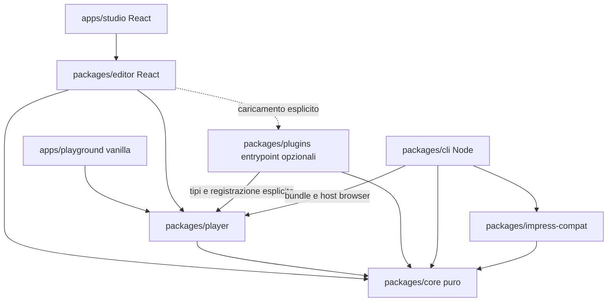

# SpatialDeck — specifica di progetto

Stato attuale: implementazione 0.1 presente e WebKit locale verificato con runner dedicato; CI Linux verificata sui tre browser con 1.64.1; dettagli in sezione 15. Baseline documentale originaria: 21 ottobre 2026. Le parole DEVE, NON DEVE e PUÒ indicano rispettivamente requisito, divieto e opzione. Questo documento è il contratto comune dei sei prompt; una deviazione motivata richiede aggiornamento coerente della specifica, della roadmap e delle migrazioni, non una modifica silenziosa.

## 1. Stato iniziale e ambito

Repository ispezionato: `/Users/master/Documents/GitHub/SpatialDeck`, commit iniziale `0c222b3`. Prima di questa redazione esisteva soltanto `LICENSE`, testo GNU GPL versione 3; nessun sorgente, manifest, indice o documento architetturale e nessuna modifica pendente. Non cambiare licenza, intestatari o condizioni per deduzione: preservare `LICENSE` e chiarire l'identificatore SPDX applicabile prima del packaging. Le posizioni dei file applicativi in questo documento sono **proposte**, non file già presenti. Gli otto Markdown richiesti sono gli unici artefatti creati in questa esecuzione.

SpatialDeck è una piattaforma open-source, local-first, per presentazioni multimediali spaziali e non lineari. Libreria TypeScript/JavaScript e Studio visuale leggono lo stesso documento e usano lo stesso player. La pubblicazione non include l'editor né React. Funzioni fondamentali, esempi e progetti locali non richiedono account, backend o servizi remoti; il primo download di strumenti/browser e l'installazione delle dipendenze possono richiedere rete.

Separazioni obbligatorie:

| Dimensione | Responsabilità | Non contiene |
| --- | --- | --- |
| Contenuto | Blocchi ordinati, asset, testo alternativo, media | Stato di selezione o coordinate camera |
| Spazio | Scene, dimensioni, trasformazioni e parent | Ordine delle visite |
| Percorso | Nodi, connessioni, scelte e history runtime | Un vincolo di camera uguale al target |
| Tempo | Durate, easing, keyframe, cue dichiarativi | JavaScript nel JSON |
| Presentazione | Camera runtime, input, pubblico e relatore | Stato persistente dell'editor |

Lo spazio è concettualmente aperto ma numericamente limitato. Una scena è un rettangolo con volume di collocazione, non una slide obbligatoriamente a pieno schermo. Può essere piccola, ruotata, annidata o parte di una panoramica.

### Casi d'uso e priorità

1. Uno sviluppatore monta una presentazione in una pagina HTML senza React, con controlli propri e due istanze indipendenti.
2. Un docente costruisce tre scene in Studio, salva e riapre il JSON e ritrova contenuti, trasformazioni e percorso identici.
3. Un ricercatore sceglie un approfondimento durante il discorso e torna con `prev()` alla visita effettiva precedente.
4. Un autore musicale integra audio/video locali e cue dichiarativi; l'avvio richiede il consenso multimediale del browser quando necessario.
5. Un relatore consegna un HTML offline compatibile e un PDF di un itinerario esplicito; eventuale video minimo è un output verificato con limiti dichiarati.

Minimo motore funzionante: 0.1. Minimo prodotto visuale funzionante: 0.2. L'etichetta 1.0 richiede tutte le verifiche della roadmap, non soltanto il completamento cronologico delle fasi.

Non-obiettivi 1.0: cloud collaborativo, autenticazione, backend multiutente, CAD, sostituzione integrale di PowerPoint, esecuzione offline arbitraria del web, fedeltà universale a plugin impress.js, renderer WebGL di base, editing 3D con gizmo completo, realtime audio professionale o sincronizzazione hardware garantita. Nessun servizio analitico o telemetria obbligatoria.

## 2. Decisioni architetturali

### Monorepo e responsabilità

| Path proposto | Pacchetto | Responsabilità e introduzione |
| --- | --- | --- |
| `packages/core` | `@spatialdeck/core` | Dominio, schema, diagnostica, migrazioni, matematica, navigazione e campionamento temporale; fase 1 |
| `packages/player` | `@spatialdeck/player` | DOM/CSS 3D, input, lifecycle e renderer contenuti; fase 1 |
| `packages/editor` | `@spatialdeck/editor` | React, comandi undo/redo, UI e storage browser; fase 2 |
| `packages/plugins` | `@spatialdeck/plugins` | Plugin SDK e renderer opzionali, entrypoint separati; fase 4 |
| `packages/cli` | `@spatialdeck/cli` | Validazione, build ed export Node; fase 5 |
| `packages/impress-compat` | `@spatialdeck/impress-compat` | Import isolato, diagnostica e adattatore eventuale; fase 6 |
| `apps/playground` | `@spatialdeck/playground` | Vite vanilla, esempi del player da fase 1 |
| `apps/studio` | `@spatialdeck/studio` | Vite + React, applicazione autoriale da fase 2 |
| `examples`, `docs`, `prompts` | Nessuno | Fixture/demo, documentazione e sei istruzioni operative |

Non creare pacchetti vuoti per simulare deliverable futuri. Tutte le librerie sono ESM, con `exports` espliciti, tipi `.d.ts`, CSS esportato separatamente se necessario, nessun effetto browser al semplice import del core. Build librerie con Vite library mode e `tsc --emitDeclarationOnly`; CLI con target Node e dipendenze native esternalizzate. React e React DOM sono peer dell'editor, mai dipendenze transitive del player.



Le frecce indicano dipendenza, non proprietà. Player espone interfacce per renderer: NON importa `plugins` né `editor`. `core` non importa DOM, React, filesystem, rete, player o plugin. I pacchetti opzionali non entrano nel bundle di default. Una verifica automatica delle dipendenze vieta archi inversi e controlla il bundle del player.

### Toolchain fissata e fonti

Versioni realmente presenti nel registry npm e nei metadati Node verificati il 21 ottobre 2026; **non è stata eseguita un'installazione né provata una build**. Questa è una baseline compatibile per engines/peer dichiarati, da confermare con installazione, typecheck, lint, build e test in fase 1. Non usare `latest` nei manifest o scaricare template non revisionati.

| Strumento | Versione fissata | Motivo/verifica |
| --- | --- | --- |
| Node.js | 24.22.0 LTS | Runtime comune; engines di tutti gli strumenti selezionati soddisfatti |
| pnpm | 12.14.0 | Workspaces e lockfile; pin in `packageManager` |
| TypeScript | 6.0.3 | `strict`, `noUncheckedIndexedAccess`, `exactOptionalPropertyTypes`; evitare TS 7 per il peer del linter |
| Vite | 8.3.5 | App e library mode; richiede Node `^20.19.0 \|\| >=22.12.0` |
| `@vitejs/plugin-react` | 6.1.2 | Peer Vite `^8.0.0`; solo da fase 2 |
| Vitest | 5.0.5 | Peer Vite include 8; Node include 24 |
| `@vitest/coverage-v8` | 5.0.5 | Versione allineata a Vitest, opzionale fino al primo report |
| `@playwright/test` | 1.64.1 | Node >=20; runner principale e CI Linux per Chromium/Firefox/WebKit |
| `@playwright/test` compatibilità macOS 14 | 1.61.1 | Eccezione autorizzata dopo verifica: workspace privato `tools/webkit-macos14`, solo WebKit su Darwin 23; non sostituisce il pin principale |
| ESLint / `@eslint/js` | 10.13.0 / 10.0.1 | Flat config, peer compatibili |
| `typescript-eslint` | 8.72.0 | Peer TS `>=4.8.4 <6.1.0`, ESLint include 10 |
| `eslint-plugin-react-hooks` | 7.1.1 | Peer ESLint include 10; fase 2 |
| Prettier | 3.9.10 | Formatter unico |
| React / React DOM | 19.3.1 / 19.3.1 | Solo editor/Studio da fase 2 |
| `@types/react` / `@types/react-dom` | 19.3.0 / 19.3.0 | Tipi allineati alla linea React scelta |
| `@types/node` | 24.19.2 | Linea del runtime |
| Ajv | 8.20.0 | JSON Schema 2020-12, compilazione standalone possibile |
| gl-matrix | 3.4.4 | Matrici/quaternioni testati, import selettivi; non un renderer |
| DOMPurify / marked / KaTeX | 3.4.17 / 18.1.1 / 0.19.0 | Fase 4, sicurezza HTML / Markdown / formule e font locali |
| fflate | 0.8.3 | Fase 4, archivio portabile di documento e asset |
| parse5 | 8.0.1 | Fase 6, parsing HTML senza esecuzione script |

Fonti primarie: [release Node](https://nodejs.org/en/about/previous-releases), [indice delle distribuzioni Node](https://nodejs.org/dist/index.json), [guida Vite](https://vite.dev/guide/), [guida Vitest](https://vitest.dev/guide/). Versioni, `engines`, `peerDependencies` e `peerDependenciesMeta` sono verificabili nei manifest del [registry TypeScript](https://registry.npmjs.org/typescript/6.0.3), [typescript-eslint](https://registry.npmjs.org/typescript-eslint/8.72.0), [Vite](https://registry.npmjs.org/vite/8.3.5), [plugin React](https://registry.npmjs.org/@vitejs/plugin-react/6.1.2), [Vitest](https://registry.npmjs.org/vitest/5.0.5), [pnpm](https://registry.npmjs.org/pnpm/12.14.0), [Playwright](https://registry.npmjs.org/@playwright/test/1.64.1). Per le altre righe usare `https://registry.npmjs.org/<nome>/<versione>` anche per nomi scoped. I peer facoltativi del plugin React non richiedono React Compiler/Babel aggiuntivi; non installarli automaticamente.

Fase 1 registra l'ambiente e l'eventuale rettifica documentata se un artefatto è ritirato o presenta una incompatibilità reale. Pin esatti e `pnpm-lock.yaml`; CI con `pnpm install --frozen-lockfile`. Non ignorare errori peer con flag forzati. Non introdurre Nx, Turborepo, server applicativi o container come prerequisiti senza bisogno misurato.

## 3. Documento, versioni e contratti

### Identità e separazione degli stati

`ProjectDocument` è JSON puro. Vietati funzioni, Date, DOM node, URL temporanei, Blob, store, selezione e history runtime. ID stabili, univoci nel rispettivo namespace, formato `[A-Za-z0-9_-]{1,96}`; riferimenti espliciti, nessun indice di array come identità. UUID compatibili sono ammessi. Ordine scene = ordine editor/outline di base; ordine blocchi = ordine DOM/lettura; presentazione = percorso scelto.

`PlayerState` contiene visita attuale, history, camera e transizione. `EditorSession` contiene selezione, viewport della mappa, undo/redo e stato dirty. `ExportManifest` descrive risorse, limitazioni e verifiche dell'output. Non serializzarli nel documento. Estensioni ignote sono preservate come JSON e non eseguite; contenuti ignoti sono placeholder con diagnostica.

### Evoluzione concordata

| Prodotto | `schemaVersion` scritto | Capacità richiesta | Cambiamento |
| --- | --- | --- | --- |
| 0.1 / 0.2 | `1.0.0` | `linear` | Scene piatte, testo, percorso lineare espresso già con nodi/edge |
| 0.3 | `1.1.0` | `linear`, `structure` se usata | Parent, grafi, camera track e cue temporali |
| 0.4 / 0.5 / 1.0 | `1.2.0` | Precedenti più `blocks` se usata | Nuovi blocchi, configurazioni plugin e media |

`requiredCapabilities` è l'elenco delle capacità realmente usate, non di tutte quelle installate. Un lettore accetta soltanto versioni per cui dispone di schema e migrazione; un minor futuro non è implicitamente leggibile. Rifiuta senza modifiche l'apertura operativa di una versione/capacità non supportata; Studio può offrire sola lettura del JSON originale. Plugin mancanti hanno invece placeholder, mantenendo integralmente i dati.

`migrateDocument(input)` restituisce nuova copia e diagnostica, applicando `1.0.0 -> 1.1.0 -> 1.2.0`, con convalida prima/dopo. Non riscrive file né altera l'originale. Nessun downgrade automatico o perdita di dati: salvare una migrazione come nuova copia o dopo scelta esplicita di sostituzione. `1.0.0 -> 1.1.0`: aggiungere `parentId: null`, `cameraTracks: []`, `cues: []`; preservare i percorsi e il testo. `1.1.0 -> 1.2.0`: preservare blocchi text, aggiungere impostazioni plugin vuote dove mancanti; nessuna riscrittura distruttiva dell'HTML. Fixture storiche rimangono nel repository e devono aprirsi nella versione corrente.

### Schema iniziale normativo

Il seguente JSON Schema è il contratto documentale completo `1.0.0`, da materializzare in fase 1 in `packages/core/schema/project-1.0.0.schema.json`. Non è un'implementazione già esistente. Ajv in modalità strict; nessun caricamento remoto di `$ref`. Tipi TypeScript derivati dallo schema o confrontati automaticamente, evitando due contratti divergenti. Formati futuri sono definiti nelle tabelle successive e riceveranno file schema dedicati nelle rispettive fasi.

Per il browser generare validatori Ajv standalone durante la build, includendo soltanto le versioni supportate. Non compilare schemi con generazione dinamica di funzioni al mount: il player deve rispettare CSP senza unsafe-eval e il bundle non deve includere l'intero compilatore Ajv. La CLI riusa gli stessi validatori; lo schema JSON resta esportabile e consultabile senza rete.

```json
{
  "$schema": "https://json-schema.org/draft/2020-12/schema",
  "$id": "urn:spatialdeck:project:1.0.0",
  "type": "object",
  "additionalProperties": false,
  "required": ["schemaVersion", "id", "metadata", "settings", "requiredCapabilities", "scenes", "assets", "paths", "defaultPathId", "extensions"],
  "properties": {
    "schemaVersion": {"const": "1.0.0"},
    "id": {"$ref": "#/$defs/id"},
    "metadata": {
      "type": "object", "additionalProperties": false,
      "required": ["title", "language"],
      "properties": {"title": {"type": "string", "maxLength": 500}, "language": {"type": "string", "minLength": 2, "maxLength": 64}, "author": {"type": "string", "maxLength": 500}, "description": {"type": "string", "maxLength": 20000}}
    },
    "settings": {
      "type": "object", "additionalProperties": false,
      "required": ["viewport", "presentation"],
      "properties": {
        "viewport": {"type": "object", "additionalProperties": false, "required": ["width", "height", "perspective"], "properties": {"width": {"$ref": "#/$defs/size"}, "height": {"$ref": "#/$defs/size"}, "perspective": {"type": "number", "minimum": 1, "maximum": 100000}}},
        "presentation": {"type": "object", "additionalProperties": false, "required": ["fit", "motion", "defaultTransition"], "properties": {"fit": {"const": "contain"}, "motion": {"enum": ["system", "reduced"]}, "defaultTransition": {"$ref": "#/$defs/transition"}}}
      }
    },
    "requiredCapabilities": {"type": "array", "uniqueItems": true, "minItems": 1, "items": {"const": "linear"}},
    "scenes": {"type": "array", "maxItems": 1000, "items": {"$ref": "#/$defs/scene"}},
    "assets": {"type": "array", "maxItems": 2000, "items": {"$ref": "#/$defs/asset"}},
    "paths": {"type": "array", "maxItems": 100, "items": {"$ref": "#/$defs/path"}},
    "defaultPathId": {"anyOf": [{"$ref": "#/$defs/id"}, {"type": "null"}]},
    "extensions": {"$ref": "#/$defs/extensions"}
  },
  "$defs": {
    "id": {"type": "string", "pattern": "^[A-Za-z0-9_-]{1,96}$"},
    "coord": {"type": "number", "minimum": -1000000, "maximum": 1000000},
    "size": {"type": "number", "minimum": 1, "maximum": 100000},
    "vec3": {"type": "array", "prefixItems": [{"$ref": "#/$defs/coord"}, {"$ref": "#/$defs/coord"}, {"$ref": "#/$defs/coord"}], "items": false, "minItems": 3},
    "transition": {"type": "object", "additionalProperties": false, "required": ["durationMs", "easing"], "properties": {"durationMs": {"type": "integer", "minimum": 0, "maximum": 60000}, "easing": {"enum": ["linear", "ease-in-out"]}}},
    "extensions": {"type": "object", "maxProperties": 100, "propertyNames": {"pattern": "^[a-z][a-z0-9.-]+$"}, "additionalProperties": {"type": "object", "additionalProperties": false, "required": ["version", "data"], "properties": {"version": {"type": "string", "pattern": "^[0-9]+\\.[0-9]+\\.[0-9]+$"}, "data": {}}}},
    "block": {"type": "object", "additionalProperties": false, "required": ["id", "type", "data"], "properties": {"id": {"$ref": "#/$defs/id"}, "type": {"const": "text"}, "data": {"type": "object", "additionalProperties": false, "required": ["text"], "properties": {"text": {"type": "string", "maxLength": 100000}}}}},
    "scene": {
      "type": "object", "additionalProperties": false,
      "required": ["id", "title", "position", "rotation", "scale", "size", "visible", "blocks", "notes", "extensions"],
      "properties": {"id": {"$ref": "#/$defs/id"}, "title": {"type": "string", "maxLength": 500}, "position": {"$ref": "#/$defs/vec3"}, "rotation": {"$ref": "#/$defs/vec3"}, "scale": {"type": "number", "minimum": 0.0001, "maximum": 10000}, "size": {"type": "array", "prefixItems": [{"$ref": "#/$defs/size"}, {"$ref": "#/$defs/size"}], "items": false, "minItems": 2}, "visible": {"type": "boolean"}, "blocks": {"type": "array", "maxItems": 100, "items": {"$ref": "#/$defs/block"}}, "notes": {"type": "string", "maxLength": 100000}, "extensions": {"$ref": "#/$defs/extensions"}}
    },
    "asset": {"type": "object", "additionalProperties": false, "required": ["id", "path", "mime", "byteLength"], "properties": {"id": {"$ref": "#/$defs/id"}, "path": {"type": "string", "minLength": 1, "maxLength": 512}, "mime": {"type": "string", "maxLength": 128}, "byteLength": {"type": "integer", "minimum": 0, "maximum": 52428800}, "sha256": {"type": "string", "pattern": "^[a-f0-9]{64}$"}}},
    "node": {"type": "object", "additionalProperties": false, "required": ["id", "sceneId", "holdMs"], "properties": {"id": {"$ref": "#/$defs/id"}, "sceneId": {"$ref": "#/$defs/id"}, "holdMs": {"type": "integer", "minimum": 0, "maximum": 3600000}}},
    "edge": {"type": "object", "additionalProperties": false, "required": ["id", "from", "to", "label", "transition"], "properties": {"id": {"$ref": "#/$defs/id"}, "from": {"$ref": "#/$defs/id"}, "to": {"$ref": "#/$defs/id"}, "label": {"type": "string", "maxLength": 500}, "transition": {"$ref": "#/$defs/transition"}}},
    "path": {"type": "object", "additionalProperties": false, "required": ["id", "name", "startNodeId", "nodes", "edges"], "properties": {"id": {"$ref": "#/$defs/id"}, "name": {"type": "string", "maxLength": 500}, "startNodeId": {"anyOf": [{"$ref": "#/$defs/id"}, {"type": "null"}]}, "nodes": {"type": "array", "maxItems": 5000, "items": {"$ref": "#/$defs/node"}}, "edges": {"type": "array", "maxItems": 10000, "items": {"$ref": "#/$defs/edge"}}}}
  }
}
```

Convalida semantica aggiuntiva: numeri finiti anche in API, ID duplicati, riferimenti, path asset e limiti cumulativi non sono risolti soltanto dallo schema. In `1.0.0` ogni percorso è una sola catena raggiungibile dal suo start, senza cicli, al massimo un ingresso/uscita per nodo; il primo nodo non ha ingressi. Ogni scena di un nodo deve esistere ed essere effettivamente visibile. ID nodo/edge sono unici nel percorso; blocchi unici nella scena; scene/path/asset/track/cue unici nelle rispettive collezioni. Un percorso vuoto ha `startNodeId: null`; un documento senza percorsi ha `defaultPathId: null`; un default non nullo deve identificare un percorso esistente. In assenza di default il mount resta empty e permette setPath. Più percorsi lineari possono essere presenti nei dati, ma la loro UI autoriale arriva in fase 3. `holdMs` è già serializzato, ignorato dalla navigazione manuale; non equivale a autoplay. Da 0.3 la semantica verifica anche finitezza e range delle pose world composte, non soltanto dei valori locali.

### Esempio documentale valido `1.0.0`

È la base della demo a tre scene della fase 1, non una fixture già implementata.

```json
{
  "schemaVersion": "1.0.0", "id": "demo-core",
  "metadata": {"title": "Tre luoghi", "language": "it", "author": "SpatialDeck example"},
  "settings": {"viewport": {"width": 1280, "height": 720, "perspective": 1000}, "presentation": {"fit": "contain", "motion": "system", "defaultTransition": {"durationMs": 600, "easing": "ease-in-out"}}},
  "requiredCapabilities": ["linear"],
  "scenes": [
    {"id": "intro", "title": "Introduzione", "position": [0,0,0], "rotation": [0,0,0], "scale": 1, "size": [960,540], "visible": true, "blocks": [{"id": "t1", "type": "text", "data": {"text": "SpatialDeck"}}], "notes": "Aprire il discorso", "extensions": {}},
    {"id": "detail", "title": "Dettaglio", "position": [1400,300,-500], "rotation": [15,25,10], "scale": 0.7, "size": [800,600], "visible": true, "blocks": [{"id": "t2", "type": "text", "data": {"text": "Una prospettiva diversa"}}], "notes": "", "extensions": {}},
    {"id": "end", "title": "Conclusione", "position": [-800,1200,200], "rotation": [0,-20,-15], "scale": 1.4, "size": [1100,500], "visible": true, "blocks": [{"id": "t3", "type": "text", "data": {"text": "Collegare le idee"}}], "notes": "", "extensions": {}}
  ],
  "assets": [],
  "paths": [{"id": "main", "name": "Principale", "startNodeId": "n1", "nodes": [{"id": "n1", "sceneId": "intro", "holdMs": 1000}, {"id": "n2", "sceneId": "detail", "holdMs": 1000}, {"id": "n3", "sceneId": "end", "holdMs": 1000}], "edges": [{"id": "e1", "from": "n1", "to": "n2", "label": "", "transition": {"durationMs": 600, "easing": "ease-in-out"}}, {"id": "e2", "from": "n2", "to": "n3", "label": "", "transition": {"durationMs": 600, "easing": "ease-in-out"}}]}],
  "defaultPathId": "main", "extensions": {}
}
```

### Estensioni normative `1.1.0` — struttura

| Entità | Campi aggiunti / regole |
| --- | --- |
| Scene | `parentId: ID \| null`, default migrato null; catena massima 32; vietati self-parent, cicli, parent assenti |
| Documento | `cameraTracks: CameraTrack[]`, `cues: Cue[]`; massimo 1000 track e 10000 cue |
| Nodo | `camera?: CameraPose`; override mondo indipendente dalla scena target |
| Edge | `cameraTrackId?: ID`, `condition?: {kind:"manual"} \| {kind:"visit-limit", maxVisits: integer 1..1000}` |
| Path | `loopPolicy?: {maxVisitsPerNode: integer 1..1000}` obbligatorio se il grafo ha cicli; tutte le connessioni di un ciclo richiedono condizione esplicita |
| CameraPose | `{position: Vec3, rotation: Vec3, zoom: number 0.0001..10000}` nel mondo, rotazioni in gradi |
| CameraTrack | `{id, keyframes: [{at: number 0..1, pose: CameraPose}], interpolation:"linear"\|"cubic", easing:"linear"\|"ease-in-out"}`; 2..200 keyframe, primo at=0, ultimo=1, at strettamente crescenti |
| Cue | `{id, edgeId, atMs: integer 0..60000, event: string, payload: JSON}`; evento namespaced e dichiarativo, tempo <= durata edge |

Tutti i nuovi oggetti hanno `additionalProperties: false`; JSON libero è ammesso soltanto nei dati di estensioni/cue. I campi opzionali assenti non cambiano comportamento. `requiredCapabilities` ammette `structure`. Percorsi ramificati richiedono questa capacità; la migrazione non attiva funzionalità che il documento non usa. Gerarchia spaziale e grafo di navigazione sono indipendenti: essere figlio non implica essere la tappa successiva. Limite visite: raggiunto il massimo un edge è disabilitato con ragione; l'utente può sempre arrestare, scegliere un'altra uscita o cambiare percorso. Nessuna condizione usa `eval` o espressioni JavaScript.

Un edge `manual` richiede edgeId esplicito anche se è l'unica uscita, quindi next senza scelta restituisce choice-required. `visit-limit.maxVisits` e `loopPolicy.maxVisitsPerNode` contano le visite completate al nodo destinazione nella history corrente: l'edge è ammesso soltanto se il nuovo ingresso non supera entrambi i limiti applicabili. Prev non consuma un nuovo ingresso e ripristina la visita con la sua posa registrata, senza ripercorrere automaticamente la track in avanti. I limiti proteggono l'avanzamento automatico, non impediscono di arrestare o cambiare percorso.

### Estensioni normative `1.2.0` — contenuti

Il blocco text esistente resta identico. Ogni nuovo blocco mantiene `{id,type,data}`; `type` discrimina il seguente union, senza cambiare `Scene.blocks`. Tutti gli oggetti data builtin rifiutano campi non definiti. Blocchi in flusso verticale nell'ordine array, layout locale confinato alle dimensioni della scena; nessun HTML può trasformare i wrapper del motore.

| `type` | `data` |
| --- | --- |
| `text` | `{text: string}` |
| `markdown` | `{source: string}`; HTML risultante sempre sanitizzato |
| `html` | `{source: string}`; sorgente conservato, vista sanitizzata |
| `svg` | `{source: string, alt: string}`; SVG sanitizzato e senza riferimenti esterni |
| `latex` | `{source: string, display: boolean, alt: string}`; KaTeX senza trust e con limiti di espansione |
| `image` | `{assetId: ID, alt: string, fit:"contain"\|"cover"}` |
| `audio` | `{assetId: ID, label: string, autoplay: boolean, loop: boolean, onExit:"pause"\|"stop"}` |
| `video` | Come audio più `{alt: string, posterAssetId?: ID, captionsAssetId?: ID}`; VTT locale |
| `link` | `{label: string, target:{pathId:ID,nodeId:ID}}`; navigazione tramite API, mai handler HTML |
| `embed` | `{url: string, title: string}`; solo HTTPS, consentimento esplicito e origine autorizzata |
| `plugin` | `{pluginId: string, apiVersion:"1.0.0", dataVersion: string, payload: JSON}`; schema dati del plugin registrato |

Stringhe source <=100000 caratteri; label/alt <=2000. Configurazione documento opzionale `pluginSettings: Record<pluginId,{apiVersion:"1.0.0",dataVersion:string,data:JSON}>`; chiavi namespaced come `org.example.diagram`. `requiredCapabilities` ammette `blocks`. Sono prescritti schema completo esportato `project-1.2.0.schema.json` e test differenziali dei tipi. Plugin assente/incompatibile: nessun caricamento da URL, placeholder e roundtrip dei dati. Un blocco non presente nell'union è errore schema; l'estensibilità passa da `type:"plugin"`, non da proprietà arbitrarie.

### Errori, diagnostica e recupero

`Diagnostic = {code, severity:"error"|"warning"|"info", pointer, message, hint?}`; pointer JSON Pointer, code stabile e messaggio localizzabile. Result discriminato `{ok:true,value,diagnostics}` oppure `{ok:false,diagnostics}`. Le API di navigazione usano il distinto `NavigationResult` della sezione 5.

- JSON illeggibile, versione ignota, numeri non finiti, riferimenti strutturali assenti: errore, nessuna sostituzione del documento corrente.
- Zero scene/path o path vuoto: documento autoriale valido; player montato in stato `empty`, controlli disabilitati e outline vuoto, niente crash.
- Asset dichiarato ma file assente, codec non supportato o plugin mancante: warning e placeholder accessibile; il documento resta apribile. Un assetId senza voce nel registro assets è invece un riferimento strutturale invalido. Export strict fallisce se il requisito del formato non è soddisfatto.
- Scena resa invisibile ma referenziata: rifiutare la modifica oppure offrire un comando atomico di rimozione dai percorsi con conferma concreta; mai saltare tappe in silenzio.
- Import parziale: candidato separato e report; niente apertura automatica o sovrascrittura dell'originale. Omettere soltanto elementi dichiarati nel report, mantenendo valido il candidato.
- Limiti difensivi iniziali: JSON 10 MiB UTF-8, profondità JSON 64, 1000 scene, 100 blocchi/scena, 2000 asset, 50 MiB/file, 200 MiB totali non compressi; archivio <=10000 entry, limite dopo decompressione. Rifiutare traversal, link simbolici e nomi duplicati normalizzati. Sono limiti di sicurezza, non garanzie di performance.

## 4. Geometria, camera e rendering

### Convenzioni uniche

Unità = pixel CSS logico a zoom 1, gradi per l'autore, millisecondi per il tempo. X positivo a destra, Y positivo in basso, Z positivo verso l'osservatore, coerente con CSS; origine iniziale al centro dello spazio. Documento a rapporto d'aspetto `viewport.width / viewport.height`, default 1280/720; letterboxing con `contain`, nessuna deformazione. Lo spazio non cambia unità su display Retina.

Colonne vettore omogenee, matrici 4x4 column-major; unica conversione `matrix3d` nel player. `rotation:[rx,ry,rz]` significa esattamente `Rz(rz) * Ry(ry) * Rx(rx)`: sul punto si applica prima X, poi Y, poi Z. `Mlocal = T(position) * Rz * Ry * Rx * S(scale)` con **scala uniforme positiva**: evita shear e decomposizioni ambigue nei reparent. Pivot fisso al centro della scena; il rettangolo contenuti va da `[-w/2,-h/2]` a `[w/2,h/2]`. Il wrapper DOM ha `transform-origin: 0 0`, il contenuto viene centrato tramite un wrapper distinto; non aggiungere implicitamente un secondo pivot CSS.

`Mworld(scene) = Mworld(parent) * Mlocal(scene)`. Dal 0.3 il DOM dei wrapper spaziali può restare piatto usando matrici world; albero logico/outline fornisce semantica e evita clipping ereditato. Visibilità effettiva = congiunzione dei parent e della scena. Reparent UI predefinito preserva la posa world con `inverse(MparentNew)*MworldOld`; non invertibile/out-of-range: comando rifiutato e nessuna mutazione parziale. L'opzione di conservare coordinate locali deve essere esplicita.

Euler è l'API autoriale leggibile. Core converte a quaternioni normalizzati per composizione/interpolazione, con slerp sull'arco breve e gestione q/-q; matrici per applicazione/inversione. Non interpolare gli elementi della matrice. Conservare i gradi inseriti senza normalizzarli distruttivamente; un giro intenzionale >180° si realizza con keyframe intermedi, non presumendo che slerp conservi il numero di giri. Test delle conversioni con tolleranza, gimbal lock e matrici composte; non richiedere identità testuale degli Euler decomposti.

### Camera

`CameraPose.position` è il punto di riferimento nel mondo al centro del piano d'inquadratura; `rotation` orienta quel piano; `zoom` è ingrandimento, non scala della scena. Non è la posizione ottica di una camera WebGL. `C = T(position) * Rz * Ry * Rx`; `V = S(zoom) * inverse(C)`. Il player applica nell'ordine concettuale `P(perspective) * V * Mworld`, poi traslazione al centro viewport e scala esterna di adattamento `min(containerWidth/viewport.width,containerHeight/viewport.height)`. Un solo punto applica la prospettiva, `perspective-origin` al centro. Riferimento per le proprietà e la composizione CSS: [CSS Transforms Level 2](https://www.w3.org/TR/css-transforms-2/).

`resolveSceneCamera(document, sceneId)` allinea il piano camera con la rotazione world della scena e imposta `zoom = min(viewportWidth/sceneWidth, viewportHeight/sceneHeight) / worldScale`, con margine 0.9. Il fattore 0.9 è moltiplicativo; testare scena al centro e dimensioni attese. Nel 0.1 ogni visita usa questa funzione. Nel 0.3 `node.camera` e gli estremi di una track sono pose mondo indipendenti dal target; il nodo resta responsabile di focus, note e storia. Fine track diversa dall'auto-fit è consentita e non produce uno snap finale. Edge senza track interpola la camera effettiva corrente verso `node.camera` o il fit della scena.

Gli estremi delle track sono pose assolute. All'avvio runtime si risolve una copia del piano sostituendo il keyframe at=0 con la posa visuale corrente: evita salti dopo un'interruzione e non modifica il documento. Gli altri keyframe e l'endpoint restano invariati. Scrub ed export usano lo stesso piano risolto, con la posa d'arrivo precedente come ingresso. Il punto at=0 salvato descrive la posa iniziale attesa per authoring, non autorizza uno snap runtime. Punti sul/dietro il piano di singolarità prospettica vengono segnalati nell'editor e restano raggiungibili tramite outline; non promettere visibilità di ogni punto 3D durante una track.

Overview/pan/zoom: strumenti di ispezione del player da fase 3, posa temporanea non salvata; un nuovo `goTo` parte dalla posa corrente. Orbit limitato e opzionale in 0.3, non condizione del MVP; inspector Euler resta sempre disponibile. L'overview include soltanto scene visibili e world bounds finite; nessuna promessa di vedere contemporaneamente qualunque profondità con una sola prospettiva.

### Tempo e rendering

Core espone campionamento puro da tempo monotono; player usa `requestAnimationFrame`, mai `setTimeout` come clock di interpolazione. In 0.1 `linear(t)=t`, `ease-in-out(t)=3t²-2t³`. Posizione lineare, rotazione slerp e zoom interpolato in log-spazio, sempre positivo. Da 0.3 la track normalizza la durata edge su [0,1], applica il proprio easing una sola volta, individua il segmento, quindi usa lineare o Catmull-Rom per posizione, slerp per rotazione e log-lineare per zoom. Catmull-Rom con estremi duplicati; sovraelongazioni oltre i limiti vengono diagnosticate. L'easing edge è usato soltanto quando manca una track.

Transizioni sospese in tab nascosta: congelare tempo attivo e riprendere senza saltare cue; export usa clock manuale. Cue si emettono una volta per transizione e solo al passaggio in avanti della soglia; annullamento sopprime cue futuri, non annulla effetti già avvenuti. Durata zero esegue cue in ordine `(atMs,id)` una volta. Ricampionare per export non emette side effect: modalità capture.

`prefers-reduced-motion: reduce` o impostazione `reduced` forza durata effettiva zero, mantiene destinazione/history/eventi senza movimento orbitale. Cambio preferenza durante una transizione la completa immediatamente con un solo commit. Autore non può forzare animazioni contro la preferenza utente.

Contenuti nativi DOM, selezionabili; no canvas/WebGL per il testo. Scene non attive restano visibili spazialmente dove previsto, ma `inert`/`aria-hidden` e senza focus interattivo. Outline lineare accessibile alternativo mostra contenuti sanitizzati e link di navigazione in ordine del percorso/ramo scelto, evitando lettura simultanea di duplicati. No culling che cancelli lo stato dei media senza lifecycle. Evitare `filter`, opacity di gruppo e overflow sui wrapper che appiattiscono `preserve-3d`; confinare stile contenuto e testare il risultato in browser.

## 5. API pubblica e macchina di navigazione

Contratti progettati, da implementare per incrementi. Le firme seguenti descrivono l'API, non costituiscono codice produttivo consegnato oggi.

| API | Contratto / fase |
| --- | --- |
| `validateDocument(input: unknown)` | Result con `ProjectDocument` della versione supportata e diagnostica; 0.1 |
| `migrateDocument(input: unknown)` | Result copia migrata alla versione corrente, originale intatto; infrastruttura 0.1, migrazioni concrete 0.3/0.4 |
| `serializeDocument(document)` | JSON deterministico, preserva array e dati estensioni; rifiuta documento invalido; 0.1 |
| `getWorldMatrix(document, sceneId)` | Result matrice, piatto 0.1, parent 0.3 |
| `resolveSceneCamera(document, sceneId)` | Result CameraPose; matematica condivisa |
| `sampleTransition(plan, elapsedMs)` | Posa pura e progresso; nessun DOM o evento |
| `createPlayer(options?)` | Istanza isolata non montata, nessuna modifica globale; 0.1 |
| `player.mount(container, document)` | `Promise<Result<void>>`; convalida, primo nodo senza animazione; mount ripetuto = errore |
| `player.destroy()` | `void`, idempotente; chiude risorse e conclude pending come cancelled |
| `player.goTo({pathId?,nodeId}, options?)` | `Promise<NavigationResult>`; ID nodo non ambiguo anche per scene ripetute; 0.1 |
| `player.next({edgeId?}?)` | Idem; 0.1 lineare, scelta edge da 0.3 |
| `player.prev()` | Idem, visita effettiva precedente; 0.1 |
| `player.setPath(pathId)` | `Promise<NavigationResult>`; start senza animazione e history azzerata |
| `player.getState()` | Snapshot readonly, nessun riferimento mutabile al motore |
| `player.on(event, handler)` | Ritorna unsubscribe; eventi tipizzati locali all'istanza |
| `player.updateDocument(document)` | `Promise<Result<void>>`, 0.2; aggiornamento validato/atomico per preview |
| `player.setView("scene"\|"overview")`, `player.setCamera(pose)` | `Result<void>`, 0.3; controllo ispezione e capture |
| `player.renderAt(plan, elapsedMs)` | `Promise<Result<void>>`, 0.5; clock manuale/capture usa gli stessi sampler e renderer |

`PlayerOptions`: input abilitabile, keymap locale, motion soltanto `system|reduced`, registry esplicito dei renderer, AssetResolver iniettato, clock opzionale, target error handler. `NavigationOptions`: `durationMs?` limitata, `signal?: AbortSignal`. Nessun HTML/handler eseguibile nelle opzioni serializzate. `AssetResolver.resolve(assetId)` restituisce URL temporaneo gestito e rilascio, mai path host nel documento.

`NavigationResult = {status:"completed"|"noop"|"cancelled"|"choice-required"|"error", diagnostic?, choices?}`. Errori operativi risolvono la Promise con esito, non rejection non gestita; handler utente che lancia viene isolato e riportato. `choices` contiene ID edge, label e ragioni di disabilitazione. Stato `unmounted|empty|idle|transitioning|destroyed`; `getState()` include `pathId`, `nodeId`, `sceneId`, `history`, `camera`, `transition`, `choices` e diagnostica. Dopo destroy nessun metodo ricrea risorse: comandi restituiscono errore `PLAYER_DESTROYED`, getState e destroy restano leciti.

### History, concorrenza e focus

- La visita iniziale è un record history. Un record ha visitId univoco, pathId, nodeId, sceneId e posa finale camera; scene ripetute hanno visite distinte.
- Destinazione/history si committano **solo a transizione completata**. Durante il movimento il nodo corrente è l'ultima visita completata, la destinazione sta in `transition.to`.
- Un comando valido successivo annulla il precedente e riparte dalla posa visuale campionata nello stesso istante. Politica latest-wins, niente coda nascosta. Un comando invalido non annulla quello valido in corso. `next()` ripetuto durante un edge continua a riferirsi all'ultimo nodo completato: non salta tappe.
- Evento annullamento e Promise `cancelled` una volta; nessun record history per destinazione annullata. AbortSignal congela la posa corrente e mantiene l'ultima visita completata. Un successivo comando riparte da lì.
- `prev()` guarda il record precedente della history effettiva. Dopo A->B->D ritorna B anche se l'array delle scene ordina A,C,B,D. Ripetizione del medesimo nodo in un loop è una visita distinta. Il record corrente è rimosso solo al completamento del ritorno; nessuna forward history implicita. Senza predecessore: noop.
- `next()` con più edge eleggibili e nessun edgeId restituisce `choice-required` senza muovere; la UI offre scelte etichettate. Nessuna selezione automatica basata sull'ordine degli array. Senza edge = noop di fine percorso. Condizioni e maxVisits si valutano sulla history del percorso corrente.
- `goTo` aggiunge una visita al percorso scelto; se passa ad altro path azzera la history, come setPath. `setPath` annulla la transizione solo dopo aver validato il nuovo percorso; path vuoto produce stato empty. Non mantenere riferimenti di history a path precedenti.
- `goTo` verso il nodo corrente è noop e non crea visite duplicate; un edge esplicito di loop può invece creare una nuova visita allo stesso nodo. Richieste noop o choice-required non annullano una transizione valida in corso. setView/setCamera interrompono un movimento prima di cambiare posa, senza aggiungere visite; prev ritorna alla posa registrata della visita precedente.
- `updateDocument` convalida prima, annulla transizione, sostituisce atomicamente; se il nodo corrente esiste lo conserva e ricostruisce camera, altrimenti seleziona start. History azzerata sulla visita risultante, così nessun record conserva riferimenti eliminati. Preview modifica senza animazione. Store editor resta unica fonte delle mutazioni, player non scrive sul documento.
- `ready`, `navigationstart`, `navigationcancel`, `scenechange`, `navigationend`, `choice`, `documentchange`, `mediaerror`, `diagnostic`, `destroy` sono eventi tipizzati con instanceId e transitionId dove pertinente. `scenechange` e navigationend soltanto sul commit; ordine da testare, unsubscribe/destroy elimina tutti gli handler.

Ordine osservabile di una navigazione: eventuale navigationcancel del piano sostituito, navigationstart del nuovo, poi al commit scenechange e navigationend, infine risoluzione completed. Il cancel emette navigationcancel e risolve cancelled una sola volta. Mount risolve dopo ready; noop non emette start/end e choice-required emette soltanto choice. Con durata zero l'ordine resta identico, senza frame intermedi. Cue usa evento tipizzato `cue` con nome/payload dichiarativi; ascoltatori lancianti sono isolati senza ricorsione infinita di diagnostic. Destroy annulla prima i pending, emette destroy e poi svuota gli handler.

Input collegato al container focusable; niente listener document/global obbligatori. Ignorare scorciatoie in input, textarea, contenteditable e controlli media; keymap personalizzabile. Focus trasferito al titolo della scena al completamento di un'azione esplicita dell'utente; la preview editor non ruba focus. `aria-live` breve annuncia titolo e scelta, non ogni frame. Due player sulla stessa pagina non intercettano gli stessi tasti se non focalizzati. Destroy cancella RAF/observer/listener, abortisce load, revoca Blob URL di proprietà, smonta DOM posseduto e ripristina attributi host toccati; non rimuove nodi dell'applicazione ospite.

## 6. Studio e persistenza

Interfaccia desktop: toolbar essenziale (nuovo, apri, salva, undo/redo, presenta), albero scene a sinistra, mappa spaziale centrale, inspector XYZ/Euler/scala/dimensioni e contenuti a destra, preview player fedele. Tipografia leggibile, focus visibile, stati vuoti e errori contestuali. La mappa 2D XY usa proiezione matematica condivisa; griglia e rettangoli sono strumenti editoriali, **non un secondo player**. Z e rotazioni nell'inspector. Niente finta preview mediante screenshot statici. Tablet con pannelli richiudibili, mobile soprattutto apertura/presentazione e inspector essenziale; editing di precisione desktop prioritario.

Store basato su comandi atomici con `apply/undo`, patch/inverse o snapshot limitati (100 comandi o 20 MiB, comportamento documentato). Drag produce preview continua ma un solo comando al rilascio, cancel ripristina. Modifica numerica non finita/scala <=0 rifiutata senza corrompere documento. Duplica genera nuovi ID per scena/blocchi; cancellazione aggiorna riferimenti nello stesso comando. Fase 2 mantiene un percorso principale lineare aggiornando i nodi; eliminare una scena dal percorso ricuce i vicini con defaultTransition e undo ripristina l'edge originale. Da fase 3 eliminare gerarchie/grafi richiede preview dei riferimenti coinvolti e scelta esplicita, senza cascade silenzioso.

Tutte le mutazioni passano da validazione core; nessuna matematica Euler/matrici duplicata nel React. Il documento cambia in memoria, preview `updateDocument` viene coalesciata al massimo una volta per frame; il salvataggio usa il medesimo snapshot convalidato. Switching edit/present crea istanze dello stesso player con input appropriato.

### Storage

IndexedDB per autosave e Blob: transazioni atomiche, asincronia e capacità più adatte di localStorage. Store proposti `documents`, `assets`, `recovery`, chiavi projectId + revision. Debounce 750 ms, flush su azione di salvataggio, visibilità come best effort; nessuna garanzia su unload. Ultime 10 revisioni, garbage collection degli asset solo se nessuna revisione li referenzia. Errore quota/storage negato: warning persistente, lavoro in memoria e download manuale ancora possibili. Startup offre confronto tra file aperto e recovery, non sostituisce file automaticamente. Due tab sullo stesso progetto rilevano revisione in conflitto e propongono copia, senza sincronizzazione collaborativa implicita.

Da 0.2 open/save `.json` via input file + download Blob; File System Access API è miglioramento facoltativo con fallback. Da 0.4 `.spatialdeck` è ZIP con `project.json`, `assets/<id>/<nome-normalizzato>` e manifest dei digest; JSON puro continua a funzionare con asset relativi e selezione cartella/file tramite resolver. Per browser privi di directory picker, importare archivio o scegliere file mancanti manualmente. Non registrare `file:///Users/...`, path assoluti, `blob:` o `data:` nel documento: incorporamento è responsabilità dell'output. Aprire un archivio non estrae mai fuori dalla root assegnata. Primo salvataggio con asset mostra chiaramente JSON con file affiancati oppure archivio portabile.

Studio offline: build statica avviabile da host locale senza Internet. Da fase 5 shell PWA cacheabile dopo primo caricamento con service worker versionato e aggiornamento esplicito; non dipendere dal service worker per player o HTML autonomo. IndexedDB non è un backup: esportazione esplicita e recovery sono distinti.

## 7. Contenuti, asset e plugin

0.1/0.2 soltanto testo via `textContent`; HTML anticipato non serve. Da fase 4 Markdown/HTML/SVG usano una pipeline unica di sanitizzazione nel player, riusata negli export e nell'editor. [DOMPurify](https://github.com/cure53/DOMPurify) è la dipendenza scelta; l'implementazione deve configurare allowlist e protezione URL e testare le proprie policy, non affidarsi a blacklist o regex. Conservare il source per editing senza inserirlo nel DOM prima della sanitizzazione.

HTML: elementi semantici, tabelle e formattazione essenziale; vietati script, handler on*, form, iframe inline, object/embed, javascript URL, meta refresh, style/link arbitrari e CSS remoto. Inline style rimosso; eventuali token di stile builtin sono classi allowlist confinate al contenuto. Link esterni HTTP(S) richiedono azione utente, `rel=noopener noreferrer`; asset incorporati referenziano ID tramite meccanismo controllato, non fetch libero. SVG vieta script, foreignObject, animazioni SMIL, riferimenti esterni, handler e CSS attivo; id locali riscritti per istanza. KaTeX `trust:false`, font bundled locali, limite macro/espansione e messaggio accessibile su formula invalida. HTML grezzo di Markdown passa dalla stessa pipeline. Esportare non attenua le policy.

L'output generato dal renderer KaTeX fidato è distinto dall'HTML utente: mantenere i soli stili di posizionamento prodotti dalla libreria, senza aprire una deroga agli style del source. Configurare maxExpand=500, maxSize=20 e macros nuove per blocco/render, evitando stato macro condiviso fra documenti; output htmlAndMathml per lettura accessibile. Queste opzioni e il loro significato sono documentati nelle [opzioni ufficiali KaTeX](https://katex.org/docs/options.html). La CSP degli export deve essere provata anche su questi stili e sui transform applicati dal player.

MIME dichiarato e sniffing minimo coerente; mai eseguire un file per determinarne il tipo. Asset immagine SVG trattato come SVG non fidato. Font solo locali/consentiti e con licenza; digest opzionale nel JSON, obbligatorio nell'archivio prodotto dalla CLI. URL temporanei appartengono al resolver e vengono rilasciati. Missing asset: dimensioni stabili, nome e azione di ripristino. Audio/video hanno controlli nativi accessibili, captions dove pertinenti e gestione Promise play rifiutata. Nessun autoplay sonoro garantito; pulsante «Abilita media» per gesto utente. Per default uscita pausa; stop azzera tempo. Destroy ferma tutto. Presenter preview sempre muta; una sola vista pubblica produce audio.

Plugin API `1.0.0`: descriptor `{id,version,apiVersion,capabilities,dataSchemas}`, `register(registry)` e renderer `{mount,update,destroy}` con host element, servizi limitati, signal e accesso agli asset; entrypoint editor separato per inspector e comandi. Eventi namespaced, unsubscribe/dispose obbligatorio, error boundary e teardown. Nessun registry globale obbligatorio. `dataVersion` migra con funzioni esplicite del plugin, senza riscritture se plugin assente. Non aggiungere dipendenze pesanti al core.

Distinguere tre livelli: JSON dichiarativo non eseguibile; HTML ammesso sanitizzato; plugin JS installato dall'host = codice fidato con autorità della pagina, **non una sandbox**. Nessun progetto può richiedere il download/esecuzione di moduli. Embed web è un iframe distinto, off per default, origine HTTPS allowlist, CSP dedicata e `sandbox` senza `allow-same-origin`, senza script salvo consenso per una capability specifica; isolare davvero il documento su origine separata se si abilita script. Non promettere isolamento per plugin JS nello stesso realm. Online/offline/capture di ogni plugin sono capability dichiarate e verificate: default non supportato.

Web MIDI è opzionale, feature detect, secure context/permesso e fallback UI; nessuna dipendenza della demo e nessun test simulato equivale a hardware reale. OSC non ha trasporto browser UDP nativo: eventuale plugin parla via WebSocket a un bridge locale esplicito, con origine/porta/autenticazione documentate; bridge fuori dal requisito 1.0 e non avviato in automatico. Cue temporali non garantiscono sincronizzazione audio al campione.

## 8. Distribuzione, export e relatore

### CLI e output

Comandi contrattuali da fase 5, binario `spatialdeck`:

| Comando | Risultato |
| --- | --- |
| `spatialdeck validate <project>` | Schema, semantica e disponibilità asset; `--json` per diagnostica |
| `spatialdeck build <project> --out <directory>` | Bundle web statico con runtime, JSON e asset, mai Studio |
| `spatialdeck export html <project> --out <file>` | HTML autonomo supportato, nessun fetch necessario |
| `spatialdeck export pdf <project> --itinerary <file> --out <file>` | Una pagina per visita/tappa dell'itinerario finito |
| `spatialdeck export video <project> --itinerary <file> --fps 30 --out <file>` | Video minimo deterministico del profilo statico |
| `spatialdeck convert impress <input.html> --out <project.json>` | Da fase 6, candidato e report sidecar |

CLI riusa core per parsing/validazione e player per vista/capture. `--out` esistente fallisce, sovrascrittura solo con flag esplicito `--overwrite`; scrittura atomica temp+rename, nessun percorso asset può uscire dalla root, nessuna shell interpolation su input. Exit code 0 riuscita (warning ammessi), 1 documento/asset/capability invalido, 2 ambiente/dipendenza mancante, 3 scrittura/export fallito. Warning sempre nel manifest. La CLI non installa automaticamente FFmpeg o browser all'atto dell'export; i browser di test si preparano con il passaggio esplicito documentato nella sezione 12. Il comando convert non è presente prima della fase 6.

Bundle embed: ESM riutilizzabile e CSS, esempio di `createPlayer` con controlli esterni; entrypoint HTML classico IIFE **generato dallo stesso player** per file autonomo. Non è un secondo motore. Export HTML incorpora JSON escapato contro `</script>`, runtime, CSS, font e asset permessi come risorse inline o Blob creati a runtime; niente import ESM esterni, fetch relativi, CDN o dipendenza da service worker. Outline statico e `noscript` per contenuti supportati. CSP con hash per script autorizzati, `connect-src 'none'` per profilo offline, niente `unsafe-eval`; evitare interpolazione HTML dei dati. Apertura reale `file://` e test con rete disabilitata, su browser matrice previsti. `file://` e storage hanno differenze browser: HTML non dipende da persistenza.

`ExportManifest` separato `{format,toolVersion,schemaVersion,itinerary?,resources:[{id,sha256,status}],warnings,unsupported,environment,verification}`. Export strict predefinito rifiuta risorse remote, plugin privi di capability offline, media/font non incorporabili. Modalità `--allow-partial` produce espliciti placeholder e manifest, non un output dichiarato pienamente offline. Dimensione target HTML <=25 MiB; oltre warning fino al limite asset, niente garanzie su dispositivi mobili. `.spatialdeck` è più efficiente per progetti grandi ma richiede Studio/CLI per aprirlo.

### Itinerario, PDF e video

Itinerary JSON esterno `{pathId,visits:[{nodeId,edgeIdToNext?}]}`; max 500 visite, finito, ID e adiacenze validati; un ciclo si esporta soltanto come visite espanse. Ogni visita usa `holdMs` del nodo e durata dell'edge uscente. `edgeIdToNext` obbligatorio quando non univoco, assente sull'ultima visita; no scelta interattiva durante capture. Primo target posizionato senza transizione; tempo totale = somma holdMs + durate edge tra visite, nessuna transizione dopo l'ultima. Visite con hold zero incluse nel PDF; video richiede durata totale >0.

PDF: Chromium via Playwright, stampa una rappresentazione 2D della posa finale di ogni visita usando il player e lo stesso renderer contenuti; una pagina dimensioni viewport, fondi inclusi, wait esplicito font/immagini/render ready. [API PDF Playwright](https://playwright.dev/docs/api/class-page#page-pdf). Non serializzare il DOM 3D intero in una sola pagina. Video/iframe diventano poster/placeholder; audio, interazioni e animazioni sono esclusi, warning nel manifest. Note escluse di default, nessuna fuga nel pubblico.

Video minimo obbligatorio 0.5: testo, immagini/SVG/formule e transizioni camera deterministiche, senza traccia audio, media dinamici o embed; output WebM con FFmpeg e codec verificato nell'ambiente. Selezionare codec realmente presente tramite `ffmpeg -encoders`, registrare versione e `ffprobe`; non promettere H.264 universale. Scheduler manuale del player campiona `t=i*1000/fps`, `N=ceil(durationMs*fps/1000)` frame; durata codificata N/fps, scarto <=1 frame. PNG via Playwright e processo FFmpeg con argv, clock/browser/font fissati; rimuovere solo temp directory di proprietà. Non usare screen recording in tempo reale come prova di timing deterministico. Identità di timing e delle pose è richiesta; pixel/hash identici solo nello stesso ambiente fissato. Dipendenze/licenze dei codec da documentare; nessun binario FFmpeg distribuito implicitamente. Riferimento operativo: [documentazione FFmpeg](https://ffmpeg.org/documentation.html).

Indici frame `i=0..N-1`: l'ultimo frame è precedente all'istante totale. L'endpoint esatto si verifica separatamente nel sampler; per renderlo visibile nel file assegnare all'ultima visita holdMs almeno pari a un frame. Il manifest registra questa quantizzazione. Capture usa una preferenza reduced-motion esplicita fissata nel piano e nell'ambiente, non quella casuale del runner; la modalità normale conserva le durate, l'output ridotto viene pianificato nuovamente senza transizioni. Per il PDF la posa di ciascuna visita è quella d'arrivo risolta, inclusi endpoint track diversi dal target, come nel player.

HTML e bundle supportano media locali testati nel browser. PDF/video hanno un profilo più ristretto, pubblicato nella UI/CLI prima dell'export. Errori di codec, font, risorse, timeout o dipendenze producono errore diagnosticato, non un file vuoto presentato come successo.

### Modalità relatore

Presenter view da fase 5: note private, titolo/nodo attuale, preview successiva (scelte se ramo ambiguo), timer monotono start/pause/reset. Pulsante apre finestra pubblica su gesto utente; popup bloccato -> istruzioni e fallback in tab locale. Sessione con ID casuale, handshake, messaggi validati, origin/source verificati via `postMessage` o BroadcastChannel same-origin. Una sola autorità di navigazione e sequence number evita feedback/loop; riconnessione risincronizza snapshot, non replay cieco. Posa/history pubblica condivisa, note mai nel DOM pubblico; esportazione pubblica le rimuove dal JSON di runtime, preservandole nel progetto autoriale. Non è protezione crittografica se si distribuisce il progetto originale. Multi-display/fullscreen dipendono dal browser; nessuna imposizione automatica dello schermo o promessa di isolamento dal mirroring OS. Funzione avanzata non garantita in HTML file://: fallback a singola finestra, supporto relatore completo tramite host locale/HTTPS.

## 9. Import impress.js e compatibilità

Fonti di riferimento: [sito ufficiale](https://impress.js.org/), [repository](https://github.com/impress/impress.js), [DOCUMENTATION.md](https://github.com/impress/impress.js/blob/master/DOCUMENTATION.md), [GettingStarted.md](https://github.com/impress/impress.js/blob/master/GettingStarted.md). Il paradigma degli step HTML spaziali è il riferimento; l'architettura SpatialDeck resta autonoma. Fase 6 fissa commit/versione delle fixture e attribuzioni prima di usare codice upstream.

| Attributo/API impress.js | Conversione prevista |
| --- | --- |
| `data-x`, `data-y`, `data-z` | Posizione del centro in unità CSS |
| `data-rotate`, `data-rotate-x/y/z` | Rotazione convertita dalla matrice sorgente |
| `data-rotate-order` | Comporre nell'ordine sorgente, poi decomporre nella convenzione SpatialDeck |
| `data-scale` | Scala uniforme positiva; valore non valido diagnosticato |
| `data-width`, `data-height`, `data-perspective`, `data-transition-duration` sul root | Viewport/prospettiva/durata; valori validati e default della baseline verificati |
| `.step`, ID e ordine DOM | Scene, nodi e percorso principale |
| `init`, `next`, `prev`, `goto` | Eventuale facade esplicita sopra un player locale |

Non copiare semplicemente gli Euler quando l'ordine cambia. Confrontare matrici e landmark proiettati, non soltanto screenshot. Default, precedenza tra alias, coordinate omesse e plugin relativi vanno verificati sulla baseline scelta: richiedere profilo esplicito per `rel`, altrimenti segnalare ambiguità. Camera originale e interpolazione SpatialDeck possono differire: nessuna equivalenza temporale garantita.

Prospettiva sorgente zero e limiti min/max di scala diversi dal fit SpatialDeck non hanno corrispondenza esatta nello schema corrente: warning esplicito e valori sorgente nel report, senza convertirli silenziosamente in equivalenti. Le risorse non incorporate restano richieste nel candidato/report.

Parsing inerte con parse5; mai aprire HTML importato come pagina eseguibile. Dimensioni/pivot/stili in whitelist statica e asset forniti dall'utente; CSS arbitrario, font remoti, transform aggiuntivi, selettori globali, script, plugin, iframe e layout dipendente dal browser producono diagnostica. Non scaricare risorse automaticamente e non dichiarare fedeltà visiva generale. Sorgente conservata fuori dal runtime; contenuti convertiti sanitizzati. Test includono sei ordini rotazione, alias, attributi mancanti/invalidi e stili non convertibili.

Adattatore opzionale solo se utile e testato: `createImpressAdapter(player)` senza `window.impress`, subset documentato e risultati coerenti con NavigationResult. Differenze su history, multiistanza, eventi, CSS e API non supportate dichiarate. Importatore essenziale è requisito 1.0; facade non lo è. Preservare licenze upstream e dipendenze, senza presumere autorizzazione a cambiare GPL del repository.

## 10. Sicurezza e accessibilità trasversali

Input di progetto/import/asset è non fidato. Confini: validazione dati in core, sanificazione DOM in player, risoluzione file confinata in CLI, plugin approvati dall'host e iframe isolati. Proteggere da prototype pollution (`__proto__`, `constructor`, `prototype` nei merge), traversal anche percent-encoded/backslash, zip bomb, URL attivi, scripting SVG, esaurimento risorse e riferimenti ciclici. Usare Map o oggetti senza prototipo per registri; nessun deep merge cieco. CSP e Trusted Types dove disponibili sono difese aggiuntive. Non usare `innerHTML` con source non passato dalla pipeline; non usare eval/Function/import dinamico da dati. Nessun segreto nelle fixture/log.

Obiettivo WCAG 2.2 AA per UI e contenuti builtin, verificato con controlli automatici e prove manuali mirate; non certificazione universale dei contenuti utente. Keyboard-only per operazioni essenziali, alternativa numerica al drag, focus visibile e ripristinato dopo dialoghi, nomi accessibili, errori associati ai campi, contrasto testo 4.5:1 e componenti 3:1, zoom browser 200%, layout utile a 320 CSS px, niente trappole focus, target touch adeguati. Outline raggiungibile e toggle riduzione movimento sempre presenti. Immagini con alt (vuoto soltanto se decorative), video con captions/transcript ove richiesto, audio con label. Documentare requisiti autoriali e diagnosticare omissioni senza inventare testo alternativo.

Da fase 1 test focus/tastiera/reduced motion/destroy, da fase 2 editor accessibile, da fase 4 sanitizzazione e media; fase 6 approfondisce, non rimanda questi requisiti. Assenza di violazioni axe non equivale a QA screen reader o visiva.

## 11. Browser matrix e limiti

Policy: ultime due versioni stabili al momento della release per Chrome, Edge, Firefox e Safari desktop. Non inventare numeri di versione ora: fase 1 e fase 6 registrano i build realmente provati. Build target browser esplicito coerente con questa policy, non semplice affidamento sul default del bundler.

| Superficie | Target e prova | Limiti/fallback |
| --- | --- | --- |
| Core | Node 24 LTS e browser moderni | Nessuna API DOM; JS number e limiti numerici dichiarati |
| Player DOM/CSS | Playwright Chromium/Firefox/WebKit da 0.1 | WebKit Playwright non equivale a Safari installato; prova Safari reale prima di 1.0 |
| Studio | Desktop matrice sopra, Chrome/Edge CI e Gecko/WebKit E2E | Download/input file fallback a File System Access; niente account |
| Tablet/mobile | Safari iPadOS/iOS e Chrome Android stabili | Smoke reale se disponibile, touch/presentazione e outline; precision editing limitato |
| Presenter | Popup/host locale o HTTPS | Popup blocking e file origin: fallback singola finestra |
| MIDI | Dove feature detect e permesso disponibili | Nessuna promessa su Safari/Firefox; disabilitazione motivata |
| PDF/video | Chromium della versione Playwright fissata | FFmpeg locale separato per video, codec verificato |
| HTML autonomo | file:// su desktop target con profilo supportato | Nessun backend/fetch/service worker; storage non richiesto |

Se un target dichiarato non può essere provato, riportare «non verificato» e tenere aperto il relativo criterio; non trasformare l'assenza di prova in compatibilità confermata. CSS 3D non disponibile o preferenza utente: outline senza movimento, contenuto leggibile e navigabile. Nessuna promessa per browser legacy.

## 12. Test, CI e budget

### Comandi e tracciabilità

Script root contrattuali da creare in fase 1: `pnpm typecheck`, `pnpm lint`, `pnpm format:check`, `pnpm test`, `pnpm test:e2e`, `pnpm build`, `pnpm check:boundaries`, `pnpm check:bundle`. `pnpm test` usa Vitest run, non watch. `pnpm dev:playground`; da fase 2 `pnpm dev:studio`; da fase 5 `pnpm spatialdeck --help` inoltra al bin CLI locale. Per installare browser necessari: `pnpm exec playwright install chromium firefox webkit`, registrando eventuali blocchi, senza installare pacchetti OS non richiesti. Lo script e2e gestisce host e teardown, non dipende da un server lasciato aperto a mano.

Ogni fase controlla manifest/script effettivi, esegue i comandi pertinenti e salva `docs/verification/phase-0.1.md`, `phase-0.2.md`, `phase-0.3.md`, `phase-0.4.md`, `phase-0.5.md`, `phase-1.0.md` nella futura implementazione. Report con ambiente/versioni, comando esatto, exit code, test pass/fail/skip, artefatti e limiti. Quei report non sono creati in questa esecuzione documentale. Un comando assente non è un test superato: implementare lo script richiesto o spiegare blocco reale. Correggere difetti e rieseguire prove coinvolte prima di dichiarare completamento.

Unità: schema/semantica/migrazioni, matrici/camera, state machine/history, sampler ed errori. Integrazione: player multiistanza, eventi, plugin lifecycle, resolver, persistence e CLI. E2E: pixel/proiezione e interazioni browser reali; editor->save->open->player; frame e export offline; importer fixture. Mocks solo per tempo/errori/permessi isolati, mai come prova che audio, export, UI o hardware funzionino. Screenshot con soglie motivate e landmark geometrici; non aggiornare snapshot per nascondere regressioni.

CI minima da fase 1: checkout, Node/pnpm pinnati, frozen install, typecheck/lint/format, unità, build, boundaries/bundle, smoke Chromium. Ampliare Firefox/WebKit, security/axe, export e regressioni nelle rispettive fasi; fase 6 matrice completa. Nessuna pubblicazione automatica. Report/log prodotti dalla CI, non screenshot inventati. Coverage obiettivo core >=85% statements e >=80% branches da fase 3; coverage non sostituisce fixture avverse.

### Budget iniziali misurabili

Sono soglie di progetto **non risultati misurati**. Fixture 100 scene, 10 blocchi text di 100 caratteri/scena, percorso 100 nodi, no media, viewport 1280x720, DPR=1; seed e font locali fissati. Hardware di riferimento da registrare (CPU/RAM/OS/power mode), browser e lockfile, build production, nessun throttling per la baseline. Cinque warm-up e venti misure; p50/p95, non il risultato migliore.

| Metrica | Gate proposto | Metodo |
| --- | --- | --- |
| Bundle default core+player | <=100 KiB gzip JS, <=20 KiB gzip CSS, React/editor assenti | Build consumer minimale e compressione riproducibile; esclusi plugin/media |
| Documento 100 scene | p95 mount-ready <=1000 ms; validazione <=100 ms | performance marks e timing core sul runner dichiarato |
| Interazione editor | p95 input->preview commit <=100 ms | 100 drag/inspector update con tracing |
| Camera 100 scene | p95 intervallo RAF <=34 ms, nessun long task >200 ms durante 10 transizioni | Traccia browser, timer sospesi esclusi e motivati; nessun claim «60 FPS» |
| Teardown | 0 risorse possedute dopo 50 mount/destroy; heap trattenuto delta <=5 MiB dopo GC controllata | Contatori listener/RAF/observer/URL + heap Chromium, rumore e limiti registrati |
| Export video fixture | frame count esatto, durata entro 1 frame, endpoint pose entro 1e-6 | ffprobe + log sampler e confronto frame iniziale/finale |

Il runner CI rumoroso usa bundle, contatori e correttezza come gate stabile; timing su runner controllato prima di 1.0, con artefatti e motivazione di eventuale revisione delle soglie. Non abbassare budget soltanto per far passare una build. Limiti di scene/asset sono separati dallo scenario prestazionale; GPU e precisione floating point impediscono uno spazio fisicamente infinito. Virtualizzazione/caching soltanto dopo benchmark e senza perdita semantica/media.

## 13. Release e debito controllato

Versioni prodotto 0.1, 0.2, 0.3, 0.4, 0.5, 1.0; API pacchetti con SemVer, schema e plugin API hanno versioni indipendenti. In fase pre-1.0 ogni breaking change richiede migrazione, changelog e fixture; da 1.0 breaking API = major. Introdurre deprecazioni esplicite, non alias silenziosi permanenti. Documenti delle fasi precedenti si conservano e si aggiornano, non si sostituiscono con un nuovo progetto.

Debito ammesso e dichiarato: mappa 2D con Z via inspector; video statico senza audio; HTML offline soltanto profilo supportato; import CSS limitato; plugin JS fidato; niente bridge OSC incluso. Un task non implementato non può essere mascherato da UI disabilitata dichiarata completa. Decisioni locali motivate consentite senza domande non essenziali; dubbi su licenza, perdita dati o modifiche distruttive richiedono evidenza e rispetto delle autorizzazioni.

1.0 richiede tutti i gate della roadmap, licenze/attribuzioni e sorgenti distribuibili, istruzioni riproducibili, nessun blocker sicurezza/dati/P0/P1, bug residui classificati. In caso contrario preparare candidato e `docs/RELEASE_BLOCKERS.md` senza taggare né dichiarare stabilità. Build/install/commit/push/publish/deploy sono azioni distinte. I sei prompt si fermano dopo la propria fase, senza eseguire la seguente, senza publish/deploy/push/tag/commit remoto e senza operazioni distruttive non richieste.

## 14. Audit della consegna documentale

Questa sezione registra il contratto da verificare anche con audit incrociato finale: sei prompt numerati, dipendenze senza React nel motore, schema/API incrementali con migrazioni, demo eseguibile a ogni fase, test e stop condition in ogni prompt, profili e dipendenze di import/export espliciti, sicurezza/accessibilità trasversali, nessuna equivalenza totale con impress.js. Questa redazione crea soltanto Markdown; nessuna fase implementativa è stata avviata e nessun test applicativo è dichiarato eseguito.

Audit finale effettivo: 32 controlli documentali superati, inclusi schema/esempio JSON, cinque negativi strutturali e integrità del perimetro dei file; dettagli in ROADMAP, sezione 7. Nessuna build o installazione applicativa è stata eseguita.

## 15. Stato effettivo dopo l'implementazione 0.1

Il 21 ottobre 2026 sono stati materializzati `packages/core`, `packages/player`, `apps/playground`, lo schema normativo 1.0.0, la fixture a tre scene, CI e controlli. Il contratto geometrico, lo schema e i pin della baseline sono invariati. [Guida/API](DEVELOPMENT.md) e [rapporto di verifica](verification/phase-0.1.md) descrivono i file reali e gli esiti; le indicazioni «proposto/non implementato» nelle sezioni storiche precedenti documentano lo stato iniziale.

I path della fase 1 corrispondono alla proposta. Aggiunte motivate: `packages/player/src/browser.ts` raccoglie CSS per Vite mantenendo le dichiarazioni pubbliche prive di import CSS irrisolti; `scripts/generate.mjs` deriva tipi e validatore dallo schema unico; `docs/verification` conserva misure e screenshot. Nessun pacchetto delle fasi successive è stato creato. Le opzioni media/plugin e gli eventi documentchange/mediaerror sono rimandati alle API che li introducono, senza stub operativi.

La vista testuale forza transizioni immediate ed è il fallback se CSS 3D manca; non modifica il documento. Le scorciatoie considerano il focus locale e non sottraggono il focus a un campo durante una transizione. La suite E2E serve la build production. La verifica locale esegue Chromium e Firefox con Playwright 1.64.1 e WebKit con il runner dedicato 1.61.1 su macOS 14: 30 E2E passati, zero skip. L'eccezione approvata evita `Unknown setting: PushAPIEnabled` senza cambiare il pin principale né il prodotto. `tools/webkit-macos14` è un workspace di tooling concreto; la suite resta unica e i report sono separati per runner. La CI Linux ha superato 85 unità e 30 E2E sui tre browser con 1.64.1, zero skip: [run 39596586324](https://github.com/fv-c/SpatialDeck/actions/runs/39596586324), commit `07916cc`. Safari reale non è stato verificato.

La licenza originale è invariata. Manifest privati, identificatore SPDX non dedotto dal solo testo GPL; packaging pubblico non effettuato. Nessuna installazione globale, tag, deploy o pubblicazione. Commit e push sono stati successivamente autorizzati: implementazione consegnata con `07916cc`, evidenza CI nel rapporto.
