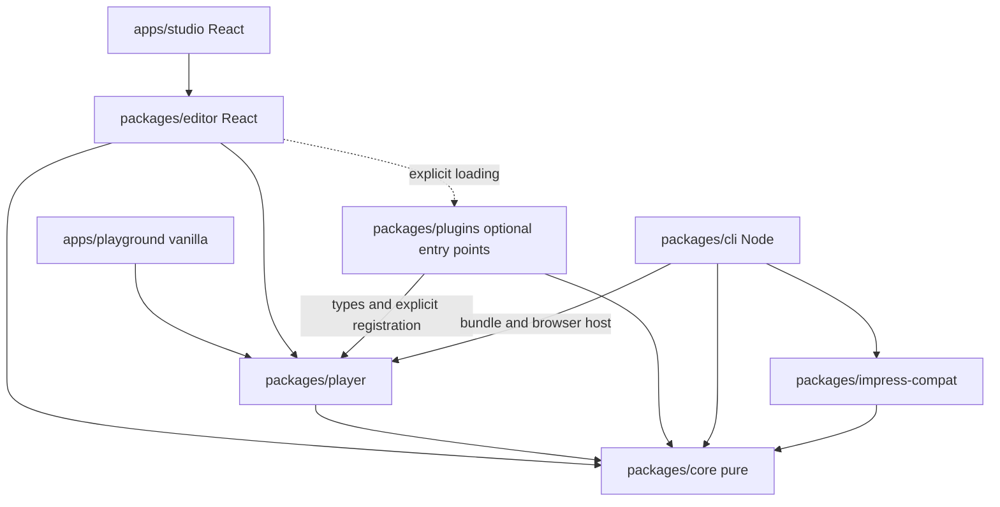

# SpatialDeck — project specification

Current state: SpatialDeck 0.4 Content implemented with schema 1.2.0, 1.0.0/1.1.0 migrations, optional renderers and local assets; checks and limits in section 18 and in the 0.4 report. After the pre-distribution audit of 22 October 2026 the plan was reformulated (section 19): decision gate G0, 0.4.1 Consolidation, 0.5 Layout with schema 1.3.0, 0.6 Distribution and 1.0 Stabilization. 0.4.1 is implemented (section 20), the G0 gate is closed (section 21), 0.5 Layout is implemented with schema 1.3.0 (section 22) and 0.6 Distribution is implemented with schema 1.3.0 unchanged (section 23). Original documentation baseline: 21 October 2026. The words MUST, MUST NOT and MAY denote a requirement, a prohibition and an option respectively. This document is the shared contract of the phase prompts; a justified deviation requires a consistent update of the specification, the roadmap and the migrations, never a silent change. Sections 1–14 keep their original wording, with phase references from the revision onwards expressed as product versions (0.6, 1.0) rather than prompt numbers.

## 1. Initial state and scope

Inspected repository: `/Users/master/Documents/GitHub/SpatialDeck`, initial commit `0c222b3`. Before this draft only `LICENSE` existed, the text of the GNU GPL version 3; no sources, manifests, indexes or architecture documents and no pending changes. Do not change the licence, its holders or its conditions by inference: preserve `LICENSE` and clarify the applicable SPDX identifier before packaging. The application file locations in this document are **proposals**, not files already present. The eight requested Markdown files are the only artefacts created in this run.

SpatialDeck is an open-source, local-first platform for spatial, non-linear multimedia presentations. A TypeScript/JavaScript library and a visual Studio read the same document and use the same player. Publishing includes neither the editor nor React. Core features, examples and local projects need no account, backend or remote service; the first download of tools and browsers and the installation of dependencies may need a network.

Mandatory separations:

| Dimension | Responsibility | Does not contain |
| --- | --- | --- |
| Content | Ordered blocks, assets, alternative text, media | Selection state or camera coordinates |
| Space | Scenes, sizes, transforms and parents | Visit order |
| Path | Nodes, connections, choices and runtime history | A camera constraint equal to the target |
| Time | Durations, easing, keyframes, declarative cues | JavaScript in the JSON |
| Presentation | Runtime camera, input, audience and presenter | Persistent editor state |

Space is conceptually open but numerically bounded. A scene is a rectangle with a placement volume, not a slide that must fill the screen. It can be small, rotated, nested or part of an overview.

### Use cases and priorities

1. A developer mounts a presentation in an HTML page without React, with their own controls and two independent instances.
2. A teacher builds three scenes in Studio, saves and reopens the JSON and finds identical content, transforms and path.
3. A researcher chooses a deep dive during the talk and returns with `prev()` to the actual previous visit.
4. A music author integrates local audio and video and declarative cues; starting playback asks for the browser's media consent when needed.
5. A presenter delivers a compatible offline HTML and a PDF of an explicit itinerary; an optional minimal video is a verified output with declared limits.

Minimum working engine: 0.1. Minimum working visual product: 0.2. The 1.0 label requires every check in the roadmap, not merely the chronological completion of the phases.

Non-goals for 1.0: collaborative cloud, authentication, multi-user backend, CAD, a full PowerPoint replacement, arbitrary offline execution of the web, universal fidelity to impress.js plugins, a base WebGL renderer, 3D editing with a full gizmo, professional real-time audio or guaranteed hardware sync. No mandatory analytics service or telemetry.

## 2. Architecture decisions

### Monorepo and responsibilities

| Proposed path | Package | Responsibility and introduction |
| --- | --- | --- |
| `packages/core` | `@spatialdeck/core` | Domain, schema, diagnostics, migrations, math, navigation and time sampling; phase 1 |
| `packages/player` | `@spatialdeck/player` | DOM/CSS 3D, input, lifecycle and content renderers; phase 1 |
| `packages/editor` | `@spatialdeck/editor` | React, undo/redo commands, UI and browser storage; phase 2 |
| `packages/plugins` | `@spatialdeck/plugins` | Plugin SDK and optional renderers, separate entry points; phase 4 |
| `packages/cli` | `@spatialdeck/cli` | Node validation, build and export; 0.6 |
| `packages/impress-compat` | `@spatialdeck/impress-compat` | Isolated import, diagnostics and an optional adapter; 1.0 |
| `apps/playground` | `@spatialdeck/playground` | Vanilla Vite, player examples from phase 1 |
| `apps/studio` | `@spatialdeck/studio` | Vite + React, authoring application from phase 2 |
| `examples`, `docs`, `prompts` | None | Fixtures and demos, documentation and six operational instructions |

Do not create empty packages to simulate future deliverables. Every library is ESM, with explicit `exports`, `.d.ts` types, CSS exported separately when needed and no browser side effect from simply importing the core. Libraries build with Vite library mode and `tsc --emitDeclarationOnly`; the CLI targets Node with native dependencies externalized. React and React DOM are peers of the editor, never transitive dependencies of the player.



The arrows denote dependency, not ownership. The player exposes interfaces for renderers: it does NOT import `plugins` or `editor`. `core` imports no DOM, React, filesystem, network, player or plugin. Optional packages never enter the default bundle. An automated dependency check forbids reverse edges and checks the player bundle.

### Pinned toolchain and sources

Versions actually present in the npm registry and in the Node metadata verified on 21 October 2026; **no installation was performed and no build was tried**. This is a baseline compatible with the declared engines and peers, to be confirmed with installation, typecheck, lint, build and tests in phase 1. Do not use `latest` in manifests or download unreviewed templates.

| Tool | Pinned version | Reason/verification |
| --- | --- | --- |
| Node.js | 24.22.0 LTS | Common runtime; engines of every selected tool satisfied |
| pnpm | 12.14.0 | Workspaces and lockfile; pinned in `packageManager` |
| TypeScript | 6.0.3 | `strict`, `noUncheckedIndexedAccess`, `exactOptionalPropertyTypes`; avoid TS 7 because of the linter peer |
| Vite | 8.3.5 | Apps and library mode; requires Node `^20.19.0 \|\| >=22.12.0` |
| `@vitejs/plugin-react` | 6.1.2 | Vite peer `^8.0.0`; only from phase 2 |
| Vitest | 5.0.5 | Vite peer includes 8; Node includes 24 |
| `@vitest/coverage-v8` | 5.0.5 | Version aligned with Vitest, optional until the first report |
| `@playwright/test` | 1.64.1 | Node >=20; main runner and Linux CI for Chromium, Firefox and WebKit |
| `@playwright/test` macOS 14 compatibility | 1.61.1 | Exception authorized after verification: private workspace `tools/webkit-macos14`, WebKit only on Darwin 23; does not replace the main pin |
| ESLint / `@eslint/js` | 10.13.0 / 10.0.1 | Flat config, compatible peers |
| `typescript-eslint` | 8.72.0 | TS peer `>=4.8.4 <6.1.0`, ESLint includes 10 |
| `eslint-plugin-react-hooks` | 7.1.1 | ESLint peer includes 10; phase 2 |
| Prettier | 3.9.10 | Single formatter |
| React / React DOM | 19.3.1 / 19.3.1 | Editor and Studio only, from phase 2 |
| `@types/react` / `@types/react-dom` | 19.3.0 / 19.3.0 | Types aligned with the chosen React line |
| `@types/node` | 24.19.2 | Runtime line |
| Ajv | 8.20.0 | JSON Schema 2020-12, standalone compilation possible |
| gl-matrix | 3.4.4 | Tested matrices and quaternions, selective imports; not a renderer |
| DOMPurify / marked / KaTeX | 3.4.17 / 18.1.1 / 0.19.0 | Phase 4, HTML, Markdown and formula safety, and local fonts |
| fflate | 0.8.3 | Phase 4, portable archive of document and assets |
| parse5 | 8.0.1 | 1.0 Stabilization, HTML parsing without script execution |

Primary sources: [Node releases](https://nodejs.org/en/about/previous-releases), [Node distribution index](https://nodejs.org/dist/index.json), [Vite guide](https://vite.dev/guide/), [Vitest guide](https://vitest.dev/guide/). Versions, `engines`, `peerDependencies` and `peerDependenciesMeta` can be checked in the manifests of the [TypeScript registry](https://registry.npmjs.org/typescript/6.0.3), [typescript-eslint](https://registry.npmjs.org/typescript-eslint/8.72.0), [Vite](https://registry.npmjs.org/vite/8.3.5), [React plugin](https://registry.npmjs.org/@vitejs/plugin-react/6.1.2), [Vitest](https://registry.npmjs.org/vitest/5.0.5), [pnpm](https://registry.npmjs.org/pnpm/12.14.0), [Playwright](https://registry.npmjs.org/@playwright/test/1.64.1). For the other rows use `https://registry.npmjs.org/<name>/<version>`, scoped names included. The optional peers of the React plugin need no extra React Compiler or Babel; do not install them automatically.

Phase 1 records the environment and any documented correction if an artefact is withdrawn or shows a real incompatibility. Exact pins and `pnpm-lock.yaml`; CI with `pnpm install --frozen-lockfile`. Do not ignore peer errors with forcing flags. Do not introduce Nx, Turborepo, application servers or containers as prerequisites without a measured need.

## 3. Document, versions and contracts

### Identity and separation of states

`ProjectDocument` is pure JSON. Functions, Dates, DOM nodes, temporary URLs, Blobs, stores, selection and runtime history are forbidden. IDs are stable, unique within their namespace, with the format `[A-Za-z0-9_-]{1,96}`; references are explicit, never an array index as identity. Compatible UUIDs are allowed. Scene order = base editor and outline order; block order = DOM and reading order; presentation = the chosen path.

`PlayerState` holds the current visit, history, camera and transition. `EditorSession` holds selection, map viewport, undo/redo and dirty state. `ExportManifest` describes the resources, limitations and checks of an output. Do not serialize them into the document. Unknown extensions are preserved as JSON and never executed; unknown content becomes placeholders with diagnostics.

### Agreed evolution

| Product | Written `schemaVersion` | Required capability | Change |
| --- | --- | --- | --- |
| 0.1 / 0.2 | `1.0.0` | `linear` | Flat scenes, text, a linear path already expressed with nodes and edges |
| 0.3 | `1.1.0` | `linear`, `structure` if used | Parents, graphs, camera tracks and time cues |
| 0.4 / 0.4.1 | `1.2.0` | The previous ones plus `blocks` if used | New blocks, plugin configuration and media |
| 0.5 / 0.6 / 1.0 | `1.3.0` | The previous ones plus `layout` if used | Block frames in canvas scenes, document theme, scene appearance, token styles |

`requiredCapabilities` lists the capabilities actually used, not every installed one. A reader accepts only versions for which it has a schema and a migration; a future minor is not implicitly readable. It refuses, without changes, the operational opening of an unsupported version or capability; Studio may offer a read-only view of the original JSON. Missing plugins instead get placeholders, keeping the data entirely.

`migrateDocument(input)` returns a new copy and diagnostics, applying `1.0.0 -> 1.1.0 -> 1.2.0 -> 1.3.0` (the last step since 0.5), with validation before and after. It never rewrites files or alters the original. No automatic downgrade or data loss: save a migration as a new copy, or after an explicit choice to replace. `1.0.0 -> 1.1.0`: add `parentId: null`, `cameraTracks: []`, `cues: []`; preserve paths and text. `1.1.0 -> 1.2.0`: preserve text blocks, add empty plugin settings where missing; no destructive rewriting of HTML. Historical fixtures stay in the repository and must open in the current version.

### Normative initial schema

The following JSON Schema is the complete `1.0.0` document contract, to be materialized in phase 1 in `packages/core/schema/project-1.0.0.schema.json`. It is not an existing implementation. Ajv in strict mode; no remote loading of `$ref`. TypeScript types derived from the schema or compared automatically, avoiding two diverging contracts. Future formats are defined in the following tables and will get dedicated schema files in their phases.

For the browser, generate standalone Ajv validators at build time, including only the supported versions. Do not compile schemas with dynamic function generation at mount: the player must respect a CSP without unsafe-eval and the bundle must not include the whole Ajv compiler. The CLI reuses the same validators; the JSON Schema stays exportable and readable without a network.

```json
{
  "$schema": "https://json-schema.org/draft/2020-12/schema",
  "$id": "urn:spatialdeck:project:1.0.0",
  "type": "object",
  "additionalProperties": false,
  "required": ["schemaVersion", "id", "metadata", "settings", "requiredCapabilities", "scenes", "assets", "paths", "defaultPathId", "extensions"],
  "properties": {
    "schemaVersion": {"const": "1.0.0"},
    "id": {"$ref": "#/$defs/id"},
    "metadata": {
      "type": "object", "additionalProperties": false,
      "required": ["title", "language"],
      "properties": {"title": {"type": "string", "maxLength": 500}, "language": {"type": "string", "minLength": 2, "maxLength": 64}, "author": {"type": "string", "maxLength": 500}, "description": {"type": "string", "maxLength": 20000}}
    },
    "settings": {
      "type": "object", "additionalProperties": false,
      "required": ["viewport", "presentation"],
      "properties": {
        "viewport": {"type": "object", "additionalProperties": false, "required": ["width", "height", "perspective"], "properties": {"width": {"$ref": "#/$defs/size"}, "height": {"$ref": "#/$defs/size"}, "perspective": {"type": "number", "minimum": 1, "maximum": 100000}}},
        "presentation": {"type": "object", "additionalProperties": false, "required": ["fit", "motion", "defaultTransition"], "properties": {"fit": {"const": "contain"}, "motion": {"enum": ["system", "reduced"]}, "defaultTransition": {"$ref": "#/$defs/transition"}}}
      }
    },
    "requiredCapabilities": {"type": "array", "uniqueItems": true, "minItems": 1, "items": {"const": "linear"}},
    "scenes": {"type": "array", "maxItems": 1000, "items": {"$ref": "#/$defs/scene"}},
    "assets": {"type": "array", "maxItems": 2000, "items": {"$ref": "#/$defs/asset"}},
    "paths": {"type": "array", "maxItems": 100, "items": {"$ref": "#/$defs/path"}},
    "defaultPathId": {"anyOf": [{"$ref": "#/$defs/id"}, {"type": "null"}]},
    "extensions": {"$ref": "#/$defs/extensions"}
  },
  "$defs": {
    "id": {"type": "string", "pattern": "^[A-Za-z0-9_-]{1,96}$"},
    "coord": {"type": "number", "minimum": -1000000, "maximum": 1000000},
    "size": {"type": "number", "minimum": 1, "maximum": 100000},
    "vec3": {"type": "array", "prefixItems": [{"$ref": "#/$defs/coord"}, {"$ref": "#/$defs/coord"}, {"$ref": "#/$defs/coord"}], "items": false, "minItems": 3},
    "transition": {"type": "object", "additionalProperties": false, "required": ["durationMs", "easing"], "properties": {"durationMs": {"type": "integer", "minimum": 0, "maximum": 60000}, "easing": {"enum": ["linear", "ease-in-out"]}}},
    "extensions": {"type": "object", "maxProperties": 100, "propertyNames": {"pattern": "^[a-z][a-z0-9.-]+$"}, "additionalProperties": {"type": "object", "additionalProperties": false, "required": ["version", "data"], "properties": {"version": {"type": "string", "pattern": "^[0-9]+\\.[0-9]+\\.[0-9]+$"}, "data": {}}}},
    "block": {"type": "object", "additionalProperties": false, "required": ["id", "type", "data"], "properties": {"id": {"$ref": "#/$defs/id"}, "type": {"const": "text"}, "data": {"type": "object", "additionalProperties": false, "required": ["text"], "properties": {"text": {"type": "string", "maxLength": 100000}}}}},
    "scene": {
      "type": "object", "additionalProperties": false,
      "required": ["id", "title", "position", "rotation", "scale", "size", "visible", "blocks", "notes", "extensions"],
      "properties": {"id": {"$ref": "#/$defs/id"}, "title": {"type": "string", "maxLength": 500}, "position": {"$ref": "#/$defs/vec3"}, "rotation": {"$ref": "#/$defs/vec3"}, "scale": {"type": "number", "minimum": 0.0001, "maximum": 10000}, "size": {"type": "array", "prefixItems": [{"$ref": "#/$defs/size"}, {"$ref": "#/$defs/size"}], "items": false, "minItems": 2}, "visible": {"type": "boolean"}, "blocks": {"type": "array", "maxItems": 100, "items": {"$ref": "#/$defs/block"}}, "notes": {"type": "string", "maxLength": 100000}, "extensions": {"$ref": "#/$defs/extensions"}}
    },
    "asset": {"type": "object", "additionalProperties": false, "required": ["id", "path", "mime", "byteLength"], "properties": {"id": {"$ref": "#/$defs/id"}, "path": {"type": "string", "minLength": 1, "maxLength": 512}, "mime": {"type": "string", "maxLength": 128}, "byteLength": {"type": "integer", "minimum": 0, "maximum": 52428800}, "sha256": {"type": "string", "pattern": "^[a-f0-9]{64}$"}}},
    "node": {"type": "object", "additionalProperties": false, "required": ["id", "sceneId", "holdMs"], "properties": {"id": {"$ref": "#/$defs/id"}, "sceneId": {"$ref": "#/$defs/id"}, "holdMs": {"type": "integer", "minimum": 0, "maximum": 3600000}}},
    "edge": {"type": "object", "additionalProperties": false, "required": ["id", "from", "to", "label", "transition"], "properties": {"id": {"$ref": "#/$defs/id"}, "from": {"$ref": "#/$defs/id"}, "to": {"$ref": "#/$defs/id"}, "label": {"type": "string", "maxLength": 500}, "transition": {"$ref": "#/$defs/transition"}}},
    "path": {"type": "object", "additionalProperties": false, "required": ["id", "name", "startNodeId", "nodes", "edges"], "properties": {"id": {"$ref": "#/$defs/id"}, "name": {"type": "string", "maxLength": 500}, "startNodeId": {"anyOf": [{"$ref": "#/$defs/id"}, {"type": "null"}]}, "nodes": {"type": "array", "maxItems": 5000, "items": {"$ref": "#/$defs/node"}}, "edges": {"type": "array", "maxItems": 10000, "items": {"$ref": "#/$defs/edge"}}}}
  }
}
```

Additional semantic validation: finite numbers in the API too, duplicate IDs, references, asset paths and cumulative limits are not settled by the schema alone. In `1.0.0` every path is a single chain reachable from its start, without cycles, with at most one entry and one exit per node; the first node has no entries. The scene of every node must exist and be effectively visible. Node and edge IDs are unique within the path; blocks are unique within the scene; scenes, paths, assets, tracks and cues are unique within their collections. An empty path has `startNodeId: null`; a document without paths has `defaultPathId: null`; a non-null default must identify an existing path. Without a default the mount stays empty and allows setPath. Several linear paths may be present in the data, but their authoring UI arrives in phase 3. `holdMs` is already serialized and ignored by manual navigation; it is not autoplay. Since 0.3 the semantics also checks finiteness and range of the composed world poses, not only of the local values.

### Valid `1.0.0` document example

It is the basis of the phase 1 three-scene demo, not a fixture already implemented.

```json
{
  "schemaVersion": "1.0.0", "id": "demo-core",
  "metadata": {"title": "Three places", "language": "en", "author": "SpatialDeck example"},
  "settings": {"viewport": {"width": 1280, "height": 720, "perspective": 1000}, "presentation": {"fit": "contain", "motion": "system", "defaultTransition": {"durationMs": 600, "easing": "ease-in-out"}}},
  "requiredCapabilities": ["linear"],
  "scenes": [
    {"id": "intro", "title": "Introduction", "position": [0,0,0], "rotation": [0,0,0], "scale": 1, "size": [960,540], "visible": true, "blocks": [{"id": "t1", "type": "text", "data": {"text": "SpatialDeck"}}], "notes": "Open the talk", "extensions": {}},
    {"id": "detail", "title": "Detail", "position": [1400,300,-500], "rotation": [15,25,10], "scale": 0.7, "size": [800,600], "visible": true, "blocks": [{"id": "t2", "type": "text", "data": {"text": "A different perspective"}}], "notes": "", "extensions": {}},
    {"id": "end", "title": "Conclusion", "position": [-800,1200,200], "rotation": [0,-20,-15], "scale": 1.4, "size": [1100,500], "visible": true, "blocks": [{"id": "t3", "type": "text", "data": {"text": "Connecting ideas"}}], "notes": "", "extensions": {}}
  ],
  "assets": [],
  "paths": [{"id": "main", "name": "Main", "startNodeId": "n1", "nodes": [{"id": "n1", "sceneId": "intro", "holdMs": 1000}, {"id": "n2", "sceneId": "detail", "holdMs": 1000}, {"id": "n3", "sceneId": "end", "holdMs": 1000}], "edges": [{"id": "e1", "from": "n1", "to": "n2", "label": "", "transition": {"durationMs": 600, "easing": "ease-in-out"}}, {"id": "e2", "from": "n2", "to": "n3", "label": "", "transition": {"durationMs": 600, "easing": "ease-in-out"}}]}],
  "defaultPathId": "main", "extensions": {}
}
```

### Normative `1.1.0` extensions — structure

| Entity | Added fields / rules |
| --- | --- |
| Scene | `parentId: ID \| null`, migrated default null; maximum chain 32; self-parents, cycles and missing parents forbidden |
| Document | `cameraTracks: CameraTrack[]`, `cues: Cue[]`; at most 1000 tracks and 10000 cues |
| Node | `camera?: CameraPose`; a world override independent of the target scene |
| Edge | `cameraTrackId?: ID`, `condition?: {kind:"manual"} \| {kind:"visit-limit", maxVisits: integer 1..1000}` |
| Path | `loopPolicy?: {maxVisitsPerNode: integer 1..1000}`, mandatory if the graph has cycles; every connection of a cycle needs an explicit condition |
| CameraPose | `{position: Vec3, rotation: Vec3, zoom: number 0.0001..10000}` in the world, rotations in degrees |
| CameraTrack | `{id, keyframes: [{at: number 0..1, pose: CameraPose}], interpolation:"linear"\|"cubic", easing:"linear"\|"ease-in-out"}`; 2..200 keyframes, first at=0, last=1, strictly increasing at |
| Cue | `{id, edgeId, atMs: integer 0..60000, event: string, payload: JSON}`; namespaced, declarative event, time <= edge duration |

Every new object has `additionalProperties: false`; free JSON is allowed only in extension and cue data. Absent optional fields do not change behaviour. `requiredCapabilities` allows `structure`. Branching paths require this capability; migration never enables features the document does not use. Spatial hierarchy and navigation graph are independent: being a child does not imply being the next stop. Visit limit: once the maximum is reached an edge is disabled with a reason; the user can always stop, choose another exit or change path. No condition uses `eval` or JavaScript expressions.

A `manual` edge needs an explicit edgeId even when it is the only exit, so next without a choice returns choice-required. `visit-limit.maxVisits` and `loopPolicy.maxVisitsPerNode` count the completed visits to the destination node in the current history: the edge is allowed only if the new entry exceeds neither applicable limit. Prev does not consume a new entry and restores the visit with its recorded pose, without automatically replaying the track forwards. The limits protect automatic advancement; they never prevent stopping or changing path.

### Normative `1.2.0` extensions — content

The existing text block stays identical. Every new block keeps `{id,type,data}`; `type` discriminates the following union, without changing `Scene.blocks`. Every builtin data object rejects undefined fields. Blocks flow vertically in array order, with local layout confined to the scene's size; no HTML can transform the engine's wrappers.

| `type` | `data` |
| --- | --- |
| `text` | `{text: string}` |
| `markdown` | `{source: string}`; the resulting HTML is always sanitized |
| `html` | `{source: string}`; source kept, sanitized view |
| `svg` | `{source: string, alt: string}`; SVG sanitized and without external references |
| `latex` | `{source: string, display: boolean, alt: string}`; KaTeX without trust and with expansion limits |
| `image` | `{assetId: ID, alt: string, fit:"contain"\|"cover"}` |
| `audio` | `{assetId: ID, label: string, autoplay: boolean, loop: boolean, onExit:"pause"\|"stop"}` |
| `video` | Like audio plus `{alt: string, posterAssetId?: ID, captionsAssetId?: ID}`; local VTT |
| `link` | `{label: string, target:{pathId:ID,nodeId:ID}}`; navigation through the API, never an HTML handler |
| `embed` | `{url: string, title: string}`; HTTPS only, explicit consent and an authorized origin |
| `plugin` | `{pluginId: string, apiVersion:"1.0.0", dataVersion: string, payload: JSON}`; data schema of the registered plugin |

Source strings <=100000 characters; labels and alt texts <=2000. Optional document configuration `pluginSettings: Record<pluginId,{apiVersion:"1.0.0",dataVersion:string,data:JSON}>`; namespaced keys such as `org.example.diagram`. `requiredCapabilities` allows `blocks`. A complete exported schema `project-1.2.0.schema.json` and differential type tests are required. Missing or incompatible plugin: no loading from URLs, a placeholder and a roundtrip of the data. A block outside the union is a schema error; extensibility goes through `type:"plugin"`, not through arbitrary properties.

### Normative `1.3.0` extensions — layout (since 0.5)

Introduced by the revision of section 19 to allow several positioned, sized and styled blocks in the same scene. The model was confirmed without changes at the G0 gate (section 21); any later variation first updates this section, the roadmap and the 0.5 prompt. The complete schema is to be materialized in `packages/core/schema/project-1.3.0.schema.json`, with a standalone validator, derived types and differential tests as for the earlier versions.

| Entity | Added fields / rules |
| --- | --- |
| Document | `theme: Theme`, mandatory; migration writes the default theme that reproduces the 1.2.0 rendering |
| Theme | `{palette: [{id: ID, value: "#rrggbb"}] (1..32, unique IDs), colors: {text, background, accent, backdrop: PaletteId}, fonts: {body: FontId, heading: FontId}, typeScale: {body: integer 8..200, title: integer 8..400}}` |
| FontId | Closed enum of local fonts with a verified licence: at least `system-sans`, `system-serif`, `system-mono`; every embedded font chosen in 0.5 enters the enum with its files, licence and attribution recorded (in 0.5: `atkinson-hyperlegible`, section 22) |
| Scene | `layout: "flow" \| "canvas"`; `appearance: {variant: "card" \| "plain", background: PaletteId \| null, titleVisible: boolean}` |
| Block | `frame?: Frame`; `style?: {align?: "start"\|"center"\|"end"\|"justify", verticalAlign?: "start"\|"center"\|"end", size?: "xs"\|"s"\|"m"\|"l"\|"xl"\|"xxl", color?: PaletteId}` |
| Frame | `{x, y, width, height, rotation, z}` in local pixels of the content rectangle, origin at the top left corner; `width,height` >= 8, `x+width <= size[0]`, `y+height <= size[1]`; `rotation` in degrees -360..360 around the frame centre; `z` integer -1000..1000 |

In `flow` blocks MUST NOT have a `frame`; in `canvas` every block MUST have one. Frames outside the rectangle, non-finite numbers and missing PaletteIds are structural errors. Array order stays the reading, DOM, tab and outline order; `z` governs only visual stacking and ties are resolved by array order. No style field is CSS: they are validated tokens that the player applies with allowlisted classes and computed CSSOM properties; `style` attributes in user HTML remain forbidden.

`requiredCapabilities` allows `layout`, mandatory if at least one scene is canvas, a block has a `style`, an appearance differs from the migrated default or the theme differs from the default. Migration does not enable `layout`. Migration `1.2.0 -> 1.3.0`: default theme (text `#172035`, background `#ffffff`, accent `#215baf`, backdrop `#e8edf4`, `system-sans`, body 28, title 46), `layout:"flow"` and `appearance:{variant:"card",background:null,titleVisible:true}` on every scene; blocks unchanged. The rendering of migrated documents MUST stay identical to 1.2.0, verified with screenshots and landmarks of the historical fixtures.

In canvas the content is clipped to the scene rectangle, on the content wrapper and never on the `preserve-3d` spatial wrappers. Text overflowing its frame stays clipped with an editorial diagnostic, without automatic resizing. `titleVisible:false` removes the title from the spatial view but keeps it as the scene's accessible name and in the outline. Palette contrast below 4.5:1 (text) or 3:1 (components) produces a warning; no colour is corrected silently. Block groups, scene templates and per-element entrance animations stay out of 1.3.0.

### Errors, diagnostics and recovery

`Diagnostic = {code, severity:"error"|"warning"|"info", pointer, message, hint?}`; the pointer is a JSON Pointer, the code is stable and the message localizable. A discriminated Result `{ok:true,value,diagnostics}` or `{ok:false,diagnostics}`. The navigation APIs use the distinct `NavigationResult` of section 5.

- Unreadable JSON, unknown version, non-finite numbers, missing structural references: an error, and no replacement of the current document.
- Zero scenes or paths, or an empty path: a valid authoring document; the player mounts in the `empty` state, with disabled controls and an empty outline, and does not crash.
- Asset declared but file missing, unsupported codec or missing plugin: a warning and an accessible placeholder; the document stays openable. An assetId with no entry in the assets registry is instead an invalid structural reference. A strict export fails if the format's requirement is not met.
- A scene made invisible while still referenced: refuse the change or offer an atomic command that removes it from the paths, with a concrete confirmation; never skip stops silently.
- Partial import: a separate candidate and a report; no automatic opening or overwriting of the original. Omit only the elements declared in the report, keeping the candidate valid.
- Initial defensive limits: 10 MiB of UTF-8 JSON, JSON depth 64, 1000 scenes, 100 blocks per scene, 2000 assets, 50 MiB per file, 200 MiB uncompressed in total; archive <=10000 entries, limit applied after decompression. Reject traversal, symbolic links and duplicate normalized names. These are safety limits, not performance guarantees.

## 4. Geometry, camera and rendering

### Single conventions

Units = logical CSS pixels at zoom 1, degrees for the author, milliseconds for time. Positive X to the right, positive Y down, positive Z towards the viewer, consistent with CSS; initial origin at the centre of space. The document has the aspect ratio `viewport.width / viewport.height`, default 1280/720; letterboxing with `contain`, no distortion. Space does not change units on Retina displays.

Homogeneous column vectors, column-major 4x4 matrices; a single `matrix3d` conversion in the player. `rotation:[rx,ry,rz]` means exactly `Rz(rz) * Ry(ry) * Rx(rx)`: X is applied to the point first, then Y, then Z. `Mlocal = T(position) * Rz * Ry * Rx * S(scale)` with a **positive uniform scale**: it avoids shear and ambiguous decompositions when reparenting. The pivot is fixed at the centre of the scene; the content rectangle goes from `[-w/2,-h/2]` to `[w/2,h/2]`. The DOM wrapper has `transform-origin: 0 0`, and the content is centred through a separate wrapper; do not implicitly add a second CSS pivot.

`Mworld(scene) = Mworld(parent) * Mlocal(scene)`. Since 0.3 the DOM of the spatial wrappers can stay flat by using world matrices; the logical tree and the outline provide semantics and avoid inherited clipping. Effective visibility = the conjunction of the parents and the scene. The default UI reparent preserves the world pose with `inverse(MparentNew)*MworldOld`; if not invertible or out of range, the command is refused with no partial mutation. The option to keep local coordinates must be explicit.

Euler angles are the readable authoring API. The core converts them to normalized quaternions for composition and interpolation, with short-arc slerp and q/-q handling, and to matrices for application and inversion. Do not interpolate matrix elements. Keep the entered degrees without normalizing them destructively; an intentional turn >180° is achieved with intermediate keyframes, without assuming that slerp preserves the number of turns. Test conversions with tolerance, gimbal lock and composed matrices; do not require textual identity of decomposed Euler angles.

Since 1.3.0 block frames are local 2D geometry of the content rectangle: they do not enter `Mworld`, they are not 3D poses and they introduce no second pivot on the spatial wrappers. Frame rotation happens in the scene plane around the frame centre. Editor and player MUST use the same core function to convert between local frame coordinates and scene coordinates; no positioning math is duplicated in React.

### Camera

`CameraPose.position` is the reference point in the world at the centre of the framing plane; `rotation` orients that plane; `zoom` is magnification, not a scene scale. It is not the optical position of a WebGL camera. `C = T(position) * Rz * Ry * Rx`; `V = S(zoom) * inverse(C)`. The player applies, in conceptual order, `P(perspective) * V * Mworld`, then a translation to the viewport centre and an outer fit scale `min(containerWidth/viewport.width,containerHeight/viewport.height)`. A single point applies the perspective, with `perspective-origin` at the centre. Reference for CSS properties and composition: [CSS Transforms Level 2](https://www.w3.org/TR/css-transforms-2/).

`resolveSceneCamera(document, sceneId)` aligns the camera plane with the scene's world rotation and sets `zoom = min(viewportWidth/sceneWidth, viewportHeight/sceneHeight) / worldScale`, with a 0.9 margin. The 0.9 factor is multiplicative; test a centred scene and the expected sizes. In 0.1 every visit uses this function. In 0.3 `node.camera` and the ends of a track are world poses independent of the target; the node remains responsible for focus, notes and history. A track end different from the auto-fit is allowed and produces no final snap. An edge without a track interpolates the current actual camera towards `node.camera` or the scene fit.

Track ends are absolute poses. At runtime start a copy of the plan is resolved by replacing the at=0 keyframe with the current visual pose: this avoids jumps after an interruption and does not change the document. The other keyframes and the endpoint stay unchanged. Scrub and export use the same resolved plan, with the previous arrival pose as input. The saved at=0 point describes the initial pose expected for authoring; it does not authorize a runtime snap. Points on or behind the plane of the perspective singularity are reported in the editor and remain reachable through the outline; never promise that every 3D point is visible during a track.

Overview, pan and zoom: player inspection tools from phase 3, a temporary pose that is not saved; a new `goTo` starts from the current pose. A limited, optional orbit in 0.3, not an MVP condition; the Euler inspector is always available. The overview includes only visible scenes with finite world bounds; no promise to see any depth at once with a single perspective.

### Time and rendering

The core exposes pure sampling from monotonic time; the player uses `requestAnimationFrame`, never `setTimeout`, as the interpolation clock. In 0.1 `linear(t)=t`, `ease-in-out(t)=3t²-2t³`. Linear position, slerp rotation and zoom interpolated in log space, always positive. Since 0.3 a track normalizes the edge duration to [0,1], applies its own easing once, finds the segment, then uses linear or Catmull-Rom for position, slerp for rotation and log-linear for zoom. Catmull-Rom with duplicated ends; overshoots beyond the limits are diagnosed. The edge easing is used only when there is no track.

Transitions suspended in a hidden tab: freeze active time and resume without skipping cues; export uses a manual clock. Cues are emitted once per transition and only when the threshold is crossed forwards; cancellation suppresses future cues and does not undo effects already applied. Zero duration runs the cues once in `(atMs,id)` order. Resampling for export has no side effects: capture mode.

`prefers-reduced-motion: reduce` or the `reduced` setting forces an effective duration of zero and keeps destination, history and events without orbital motion. A preference change during a transition completes it immediately with a single commit. An author cannot force animations against the user's preference.

Native DOM content, selectable; no canvas or WebGL for text. Inactive scenes stay spatially visible where intended, but `inert`/`aria-hidden` and without interactive focus. An accessible alternative linear outline shows sanitized content and navigation links in the order of the chosen path or branch, avoiding simultaneous reading of duplicates. No culling that wipes media state without a lifecycle. Avoid `filter`, group opacity and overflow on wrappers that flatten `preserve-3d`; confine content styles and test the result in browsers.

## 5. Public API and navigation machine

Designed contracts, to be implemented incrementally. The following signatures describe the API; they are not production code delivered today.

| API | Contract / phase |
| --- | --- |
| `validateDocument(input: unknown)` | Result with a `ProjectDocument` of the supported version and diagnostics; 0.1 |
| `migrateDocument(input: unknown)` | Result with a copy migrated to the current version, original untouched; infrastructure in 0.1, concrete migrations in 0.3/0.4 |
| `serializeDocument(document)` | Deterministic JSON, preserving arrays and extension data; rejects an invalid document; 0.1 |
| `getWorldMatrix(document, sceneId)` | Result with a matrix, flat in 0.1, parents in 0.3 |
| `resolveSceneCamera(document, sceneId)` | Result with a CameraPose; shared math |
| `sampleTransition(plan, elapsedMs)` | Pure pose and progress; no DOM or events |
| `createPlayer(options?)` | Isolated, unmounted instance, no global changes; 0.1 |
| `player.mount(container, document)` | `Promise<Result<void>>`; validates, first node without animation; mounting again = error |
| `player.destroy()` | `void`, idempotent; closes resources and settles pending work as cancelled |
| `player.goTo({pathId?,nodeId}, options?)` | `Promise<NavigationResult>`; node IDs are unambiguous even for repeated scenes; 0.1 |
| `player.next({edgeId?}?)` | Same; linear in 0.1, edge choice from 0.3 |
| `player.prev()` | Same, the actual previous visit; 0.1 |
| `player.setPath(pathId)` | `Promise<NavigationResult>`; start without animation and history cleared |
| `player.getState()` | Read-only snapshot, no mutable reference to the engine |
| `player.on(event, handler)` | Returns unsubscribe; typed events local to the instance |
| `player.updateDocument(document)` | `Promise<Result<void>>`, 0.2; validated, atomic update for previews |
| `player.setView("scene"\|"overview")`, `player.setCamera(pose)` | `Result<void>`, 0.3; inspection control and capture |
| `player.renderAt(plan, elapsedMs)` | `Promise<Result<void>>`, 0.6; manual clock and capture use the same samplers and renderers |

`PlayerOptions`: optional input, local keymap, motion only `system|reduced`, an explicit renderer registry, an injected AssetResolver, an optional clock, an error handler. `NavigationOptions`: a bounded `durationMs?`, `signal?: AbortSignal`. No executable HTML or handler in serialized options. `AssetResolver.resolve(assetId)` returns a managed temporary URL and a release, never a host path in the document. Since 0.4.1 `PlayerOptions.messages` replaces every string of the player interface (controls, empty states, choices, builtin renderer errors) with documented defaults; the player applies `metadata.language` as the `lang` of its root and contains no interface text that cannot be replaced.

`NavigationResult = {status:"completed"|"noop"|"cancelled"|"choice-required"|"error", diagnostic?, choices?}`. Operational errors resolve the Promise with an outcome, never an unhandled rejection; a throwing user handler is isolated and reported. `choices` holds edge IDs, labels and reasons for disabling. State `unmounted|empty|idle|transitioning|destroyed`; `getState()` includes `pathId`, `nodeId`, `sceneId`, `history`, `camera`, `transition`, `choices` and diagnostics. After destroy no method recreates resources: commands return the `PLAYER_DESTROYED` error, while getState and destroy stay allowed.

### History, concurrency and focus

- The initial visit is a history record. A record has a unique visitId, pathId, nodeId, sceneId and the final camera pose; repeated scenes have distinct visits.
- Destination and history are committed **only when the transition completes**. During the movement the current node is the last completed visit, and the destination sits in `transition.to`.
- A later valid command cancels the previous one and restarts from the visual pose sampled at the same instant. Latest-wins policy, no hidden queue. An invalid command does not cancel the valid one in progress. Repeated `next()` during an edge keeps referring to the last completed node: it does not skip stops.
- The cancel event and the `cancelled` Promise happen once; no history record for a cancelled destination. AbortSignal freezes the current pose and keeps the last completed visit. A later command restarts from there.
- `prev()` looks at the previous record of the actual history. After A->B->D it returns to B even if the scene array orders A,C,B,D. Repeating the same node in a loop is a distinct visit. The current record is removed only when the return completes; no implicit forward history. Without a predecessor: noop.
- `next()` with several eligible edges and no edgeId returns `choice-required` without moving; the UI offers labelled choices. No automatic selection based on array order. No edge = end-of-path noop. Conditions and maxVisits are evaluated on the history of the current path.
- `goTo` adds a visit to the chosen path; switching to another path clears the history, like setPath. `setPath` cancels the transition only after validating the new path; an empty path produces the empty state. Keep no history references to previous paths.
- `goTo` towards the current node is a noop and creates no duplicate visits; an explicit loop edge can instead create a new visit to the same node. Noop or choice-required requests do not cancel a valid transition in progress. setView and setCamera interrupt a movement before changing pose, without adding visits; prev returns to the recorded pose of the previous visit.
- `updateDocument` validates first, cancels the transition and replaces atomically; if the current node exists it is kept and the camera rebuilt, otherwise the start is selected. The history is cleared down to the resulting visit, so no record keeps deleted references. Preview edits happen without animation. The editor store remains the single source of mutations; the player never writes to the document. Since 0.4.1 the update is incremental: it rebuilds only changed scenes and blocks, does not resolve unchanged assets again and does not recompute their digests; the observable result stays that of an atomic replacement.
- `ready`, `navigationstart`, `navigationcancel`, `scenechange`, `navigationend`, `choice`, `documentchange`, `mediaerror`, `diagnostic` and `destroy` are typed events with instanceId and transitionId where relevant. `scenechange` and navigationend only on commit; the order must be tested, and unsubscribe/destroy removes every handler.

Observable order of a navigation: any navigationcancel of the replaced plan, navigationstart of the new one, then at commit scenechange and navigationend, and finally completed resolution. Cancel emits navigationcancel and resolves cancelled exactly once. Mount resolves after ready; noop emits no start or end, and choice-required emits only choice. With zero duration the order stays identical, without intermediate frames. Cues use the typed `cue` event with declarative name and payload; throwing listeners are isolated without infinite diagnostic recursion. Destroy first cancels pending work, emits destroy and then empties the handlers.

Input is bound to the focusable container; no mandatory document or global listeners. Ignore shortcuts in inputs, textareas, contenteditable and media controls; the keymap is customizable. Focus moves to the scene title when an explicit user action completes; the editor preview never steals focus. A short `aria-live` announces the title and the choice, not every frame. Two players on the same page do not intercept the same keys unless focused. Destroy cancels rAF, observers and listeners, aborts loads, revokes owned Blob URLs, unmounts owned DOM and restores the host attributes it touched; it never removes nodes of the host application.

## 6. Studio and persistence

Desktop interface: an essential toolbar (new, open, save, undo/redo, present), the scene tree on the left, the spatial map in the centre, the XYZ/Euler/scale/size and content inspector on the right, a faithful player preview. Readable typography, visible focus, empty states and contextual errors. The 2D XY map uses the shared mathematical projection; grid and rectangles are editorial tools, **not a second player**. Z and rotations live in the inspector. No fake preview through static screenshots. Tablets with collapsible panels; phones mainly for opening, presenting and an essential inspector; precision editing on desktop takes priority.

A store based on atomic commands with `apply/undo`, patch/inverse or bounded snapshots (100 commands or 20 MiB, documented behaviour). A drag produces a continuous preview but a single command on release; cancel restores. A non-finite numeric edit or scale <=0 is refused without corrupting the document. Duplicate generates new IDs for the scene and its blocks; deletion updates references in the same command. Phase 2 keeps a linear main path by updating the nodes; removing a scene from the path stitches its neighbours with defaultTransition and undo restores the original edge. From phase 3, deleting hierarchies or graphs requires a preview of the references involved and an explicit choice, with no silent cascade.

Every mutation goes through core validation; no Euler or matrix math is duplicated in React. The document changes in memory, and the `updateDocument` preview is coalesced to at most once per frame; saving uses the same validated snapshot. Switching between editing and presenting creates instances of the same player with the appropriate input.

### Scene editor (since 0.5)

With a scene selected, the **Layout** mode frames the player preview with `resolveSceneCamera`, so the scene appears head-on and fitted, and overlays handles computed by the core frame math. There is no React renderer for blocks: the visible content and style are the player's. Operations: single and multiple selection, moving, resizing and rotating by dragging, arrows (1 px, 10 px with Shift), numeric fields equivalent to dragging, align and distribute, optional snap to grid, bring forward and send backward (`z`) and a **Reading order** panel (array order). Every gesture produces a single undo/redo command; Escape cancels the gesture in progress.

**Convert to canvas** creates the initial frames from the block rectangles measured in the preview, in a single command; switching back to flow removes the frames with an explicit confirmation of the loss of positions. Theme, scene appearance and block style are edited through tokens only. While dragging, the preview MUST stay within the input→preview budget of section 12, which requires the incremental update introduced in 0.4.1. Clipped text, overlapping frames that cover interactive controls and insufficient contrast produce visible diagnostics in the editor.

Store and storage, since 0.4.1: publishing the snapshot neither serializes nor freezes the whole document on every selection or map pan; autosave neither recomputes digests nor rewrites the bytes of unchanged assets; IndexedDB handles `versionchange`/`blocked` by reopening the connection or with an explicit warning; the user can delete local projects and revisions; recovery is offered only if the revision differs from the saved document.

### Storage

IndexedDB for autosave and Blobs: atomic transactions, asynchrony and capacity better suited than localStorage. Proposed stores `documents`, `assets`, `recovery`, keyed by projectId + revision. 750 ms debounce, flush on the save action, visibility as best effort; no guarantee on unload. The last 10 revisions, with garbage collection of assets only when no revision references them. Quota error or denied storage: a persistent warning, with in-memory work and manual download still possible. Startup offers a comparison between the opened file and recovery and never replaces the file automatically. Two tabs on the same project detect the conflicting revision and offer a copy, without implicit collaborative sync.

From 0.2, open and save `.json` through a file input and a Blob download; the File System Access API is an optional enhancement with a fallback. From 0.4 `.spatialdeck` is a ZIP with `project.json`, `assets/<id>/<normalized-name>` and a digest manifest; plain JSON keeps working with relative assets and folder or file selection through the resolver. For browsers without a directory picker, import the archive or pick the missing files by hand. Never record `file:///Users/...`, absolute paths, `blob:` or `data:` in the document: embedding is the output's responsibility. Opening an archive never extracts outside the assigned root. The first save with assets clearly presents JSON with files alongside or a portable archive.

Offline Studio: a static build that starts from a local host without Internet. From 0.6, a PWA shell cacheable after the first load with a versioned service worker and explicit updates; the player and the standalone HTML never depend on the service worker. IndexedDB is not a backup: explicit export and recovery are distinct.

## 7. Content, assets and plugins

0.1/0.2 support only text through `textContent`; early HTML is not needed. From phase 4 Markdown, HTML and SVG use a single sanitization pipeline in the player, reused by exports and the editor. [DOMPurify](https://github.com/cure53/DOMPurify) is the chosen dependency; the implementation must configure allowlists and URL protection and test its own policies, never rely on blacklists or regexes. Keep the source for editing without inserting it into the DOM before sanitization.

HTML: semantic elements, tables and essential formatting; scripts, on* handlers, forms, inline iframes, object/embed, javascript URLs, meta refresh, arbitrary style/link and remote CSS are forbidden. Inline styles are removed; any builtin style tokens are allowlisted classes confined to the content. External HTTP(S) links require a user action and `rel=noopener noreferrer`; embedded assets reference IDs through a controlled mechanism, not free fetches. SVG forbids scripts, foreignObject, SMIL animations, external references, handlers and active CSS; local ids are rewritten per instance. KaTeX with `trust:false`, bundled local fonts, macro and expansion limits and an accessible message on an invalid formula. Raw HTML inside Markdown goes through the same pipeline. Exporting never relaxes the policies.

The output generated by the trusted KaTeX renderer is distinct from user HTML: keep only the positioning styles produced by the library, without opening an exception for styles in the source. Configure maxExpand=500, maxSize=20 and fresh macros per block and render, avoiding macro state shared between documents; htmlAndMathml output for accessible reading. These options and their meaning are documented in the [official KaTeX options](https://katex.org/docs/options.html). The export CSP must be tested on these styles too and on the transforms applied by the player.

Token styles since 1.3.0: palette, fonts and type scale of the theme, scene appearance and block style are enumerated values or validated references, never CSS strings. The player translates them into allowlisted classes and custom properties set through the CSSOM with already validated values (colours only as `#rrggbb`), compatible with a CSP without `unsafe-inline` for scripts. Theme fonts are local files with a recorded licence, loaded only when used and embeddable in exports.

Declared MIME type and consistent minimal sniffing; never execute a file to determine its type. Signature checks MUST accept common valid files: SVG with an XML prologue, comments or a DOCTYPE before the root; UTF-8 text whose first read chunk splits a multibyte character (streaming decoding). The SHA-256 digest requires `crypto.subtle`, available only in secure contexts: over non-localhost HTTP the resolver MUST use a local digest implementation or produce an explicit diagnostic, never a silent asset failure. An SVG image asset is treated as untrusted SVG. Fonts only local or allowed and licensed; digest optional in the JSON, mandatory in the archive produced by the CLI. Temporary URLs belong to the resolver and are released. Missing asset: stable size, name and a recovery action. Audio and video have accessible native controls, captions where relevant and handling of a rejected play Promise. No audible autoplay is guaranteed; an «Enable media» button for the user gesture. By default exit pauses; stop resets the time. Destroy stops everything. The presenter preview is always muted; a single audience view plays audio.

Plugin API `1.0.0`: descriptor `{id,version,apiVersion,capabilities,dataSchemas}`, `register(registry)` and a renderer `{mount,update,destroy}` with a host element, limited services, a signal and access to assets; a separate editor entry point for inspectors and commands. Namespaced events, mandatory unsubscribe/dispose, error boundary and teardown. No mandatory global registry. `dataVersion` migrates through the plugin's explicit functions, with no rewriting when the plugin is missing. Do not add heavy dependencies to the core.

Distinguish three levels: non-executable declarative JSON; allowed, sanitized HTML; a JS plugin installed by the host = trusted code with the page's authority, **not a sandbox**. No project can request the download or execution of modules. A web embed is a distinct iframe, off by default, with an HTTPS origin allowlist, a dedicated CSP and a `sandbox` without `allow-same-origin`, without scripts unless consented for a specific capability; really isolate the document on a separate origin if scripts are enabled. Do not promise isolation for JS plugins in the same realm. Online, offline and capture support of each plugin are declared and verified capabilities: unsupported by default.

Web MIDI is optional, feature-detected, behind a secure context and permission, with a UI fallback; no demo dependency, and no simulated test is equivalent to real hardware. OSC has no native browser UDP transport: a possible plugin talks over WebSocket to an explicit local bridge, with documented origin, port and authentication; the bridge is outside the 1.0 requirements and never starts automatically. Time cues do not guarantee sample-accurate audio sync.

## 8. Distribution, export and presenter

### CLI and outputs

Contract commands from 0.6, binary `spatialdeck`:

| Command | Result |
| --- | --- |
| `spatialdeck validate <project>` | Schema, semantics and asset availability; `--json` for diagnostics |
| `spatialdeck build <project> --out <directory>` | Static web bundle with runtime, JSON and assets, never Studio |
| `spatialdeck export html <project> --out <file>` | Supported standalone HTML, no fetch needed |
| `spatialdeck export pdf <project> --itinerary <file> --out <file>` | One page per visit or stop of the finite itinerary |
| `spatialdeck export video <project> --itinerary <file> --fps 30 --out <file>` | Deterministic minimal video of the static profile |
| `spatialdeck convert impress <input.html> --out <project.json>` | From 1.0, a candidate and a sidecar report |

The CLI reuses the core for parsing and validation and the player for views and capture. An existing `--out` fails, overwriting only with the explicit `--overwrite` flag; atomic temp+rename writes, no asset path may leave the root, no shell interpolation of input. Exit codes 0 success (warnings allowed), 1 invalid document, asset or capability, 2 missing environment or dependency, 3 write or export failure. Warnings always go into the manifest. The CLI never installs FFmpeg or browsers automatically at export time; test browsers are prepared with the explicit step documented in section 12. The convert command is not present before 1.0.

Embed bundle: reusable ESM and CSS, a `createPlayer` example with external controls; a classic IIFE HTML entry point **generated from the same player** for standalone files. It is not a second engine. The HTML export embeds the JSON escaped against `</script>`, the runtime, CSS, fonts and allowed assets as inline resources or Blobs created at runtime; no external ESM imports, relative fetches, CDNs or service-worker dependency. A static outline and `noscript` for supported content. A CSP with hashes for authorized scripts, `connect-src 'none'` for the offline profile, no `unsafe-eval`; avoid HTML interpolation of data. Real opening from `file://` and tests with the network disabled, on the planned browser matrix. `file://` and storage differ across browsers: the HTML does not depend on persistence. Every output reproduces the 1.3.0 layout, theme and theme fonts with the same player; embedded fonts carry their licence in the manifest. The CSP policy for the inline styles generated by KaTeX (`style-src`) is decided and justified at the start of 0.6, not adjusted at the end of the phase.

Packaging since 0.6, from the findings of the 0.4 audit: third-party libraries stay external dependencies of the packages, not copied into `dist`; every distributed artefact that embeds their code (IIFE, standalone HTML) includes the licence notices in a generated third-party file. Complete manifests (`license: "GPL-3.0-or-later"` per the G0 decision of section 21, `description`, `repository`, `homepage`, `keywords`, `sideEffects`, `engines`, a README per package), the React peer as a compatible range, consistent internal dependencies. Optional renderers loadable on demand; KaTeX fonts distributed as woff2 files, not `data:` in three formats. The bundle budget is also measured on a realistic consumer with rich content, beyond the minimal core+player. At least one E2E suite uses the `pnpm pack` tarballs installed in an external consumer, not the sources through aliases.

A separate `ExportManifest` `{format,toolVersion,schemaVersion,itinerary?,resources:[{id,sha256,status}],warnings,unsupported,environment,verification}`. The default strict export rejects remote resources, plugins without the offline capability and non-embeddable media or fonts. The `--allow-partial` mode produces explicit placeholders and a manifest, not an output declared fully offline. HTML target size <=25 MiB; beyond that a warning up to the asset limit, with no guarantees on mobile devices. `.spatialdeck` is more efficient for large projects but needs Studio or the CLI to open it.

### Itinerary, PDF and video

An external itinerary JSON `{pathId,visits:[{nodeId,edgeIdToNext?}]}`; at most 500 visits, finite, with IDs and adjacencies validated; a cycle is exported only as expanded visits. Each visit uses the node's `holdMs` and the duration of the outgoing edge. `edgeIdToNext` is mandatory when not unique and absent on the last visit; no interactive choice during capture. The first target is positioned without a transition; total time = the sum of holdMs + edge durations between visits, with no transition after the last. Visits with zero hold are included in the PDF; video requires a total duration >0.

PDF: Chromium through Playwright prints a 2D representation of the final pose of each visit using the player and the same content renderer; one page with the viewport's size, backgrounds included, and an explicit wait for fonts, images and render ready. [Playwright PDF API](https://playwright.dev/docs/api/class-page#page-pdf). Do not serialize the whole 3D DOM into a single page. Videos and iframes become posters or placeholders; audio, interactions and animations are excluded, with a warning in the manifest. Notes are excluded by default, with no leak to the audience.

Mandatory minimal video in 0.6: text, images, SVG and formulas and deterministic camera transitions, without an audio track, dynamic media or embeds; WebM output with FFmpeg and a codec verified in the environment. Select a codec actually present through `ffmpeg -encoders` and record the version and `ffprobe`; do not promise universal H.264. The player's manual scheduler samples `t=i*1000/fps`, `N=ceil(durationMs*fps/1000)` frames; encoded duration N/fps, deviation <=1 frame. PNGs through Playwright and an FFmpeg process with argv, with clock, browser and fonts fixed; remove only owned temp directories. Do not use real-time screen recording as proof of deterministic timing. Identity of timing and poses is required; identical pixels or hashes only in the same fixed environment. Codec dependencies and licences must be documented; no FFmpeg binary is distributed implicitly. Operational reference: [FFmpeg documentation](https://ffmpeg.org/documentation.html).

Frame indices `i=0..N-1`: the last frame precedes the total instant. The exact endpoint is checked separately in the sampler; to make it visible in the file, give the last visit a holdMs of at least one frame. The manifest records this quantization. Capture uses an explicit reduced-motion preference fixed in the plan and the environment, not the runner's random one; normal mode keeps the durations, and reduced output is planned again without transitions. For the PDF, the pose of each visit is the resolved arrival pose, track endpoints different from the target included, as in the player.

HTML and bundles support local media tested in the browser. PDF and video have a narrower profile, published in the UI and CLI before exporting. Codec, font, resource, timeout or dependency errors produce a diagnosed error, never an empty file presented as success.

### Presenter mode

Presenter view since 0.6: private notes, current title and node, a preview of the next one (choices if the branch is ambiguous), a monotonic start/pause/reset timer. A button opens the audience window on a user gesture; a blocked pop-up -> instructions and a fallback in the local tab. A session with a random ID, a handshake, validated messages and origin and source checked through `postMessage` or a same-origin BroadcastChannel. A single navigation authority and sequence numbers avoid feedback and loops; reconnection resyncs from a snapshot, not a blind replay. Shared public pose and history, notes never in the public DOM; public export removes them from the runtime JSON while keeping them in the authoring project. This is not cryptographic protection if the original project is distributed. Multiple displays and full screen depend on the browser; no automatic imposition of the screen and no promise of isolation from operating-system mirroring. An advanced feature not guaranteed in `file://` HTML: fallback to a single window, full presenter support through a local host or HTTPS.

## 9. impress.js import and compatibility

Reference sources: [official site](https://impress.js.org/), [repository](https://github.com/impress/impress.js), [DOCUMENTATION.md](https://github.com/impress/impress.js/blob/master/DOCUMENTATION.md), [GettingStarted.md](https://github.com/impress/impress.js/blob/master/GettingStarted.md). The paradigm of spatial HTML steps is the reference; the SpatialDeck architecture stays independent. Phase 6 pins the commit or version of the fixtures and the attributions before using upstream code.

| impress.js attribute/API | Planned conversion |
| --- | --- |
| `data-x`, `data-y`, `data-z` | Position of the centre in CSS units |
| `data-rotate`, `data-rotate-x/y/z` | Rotation converted from the source matrix |
| `data-rotate-order` | Compose in the source order, then decompose in the SpatialDeck convention |
| `data-scale` | Positive uniform scale; invalid values diagnosed |
| `data-width`, `data-height`, `data-perspective`, `data-transition-duration` on the root | Viewport, perspective, duration; validated values and verified baseline defaults |
| `.step`, IDs and DOM order | Scenes, nodes and main path |
| `init`, `next`, `prev`, `goto` | An optional explicit facade on top of a local player |

Do not simply copy Euler angles when the order changes. Compare matrices and projected landmarks, not only screenshots. Defaults, precedence between aliases, omitted coordinates and relative plugins must be checked against the chosen baseline: require an explicit profile for `rel`, otherwise report the ambiguity. The original camera and SpatialDeck interpolation may differ: no timing equivalence is guaranteed.

A zero source perspective and min/max scale limits different from the SpatialDeck fit have no exact match in the current schema: an explicit warning and the source values in the report, without silently converting them to equivalents. Resources not embedded stay requested in the candidate and the report.

Inert parsing with parse5; never open imported HTML as an executable page. Sizes, pivots and styles from a static whitelist and assets supplied by the user; arbitrary CSS, remote fonts, extra transforms, global selectors, scripts, plugins, iframes and browser-dependent layout produce diagnostics. Do not download resources automatically and do not claim general visual fidelity. The source is kept outside the runtime; converted content is sanitized. Tests include six rotation orders, aliases, missing or invalid attributes and non-convertible styles.

An optional adapter only if useful and tested: `createImpressAdapter(player)` without `window.impress`, a documented subset and results consistent with NavigationResult. Differences in history, multiple instances, events, CSS and unsupported APIs are declared. The essential importer is a 1.0 requirement; the facade is not. Preserve upstream licences and dependencies, without assuming permission to change the repository's GPL.

## 10. Cross-cutting security and accessibility

Project, import and asset input is untrusted. Boundaries: data validation in the core, DOM sanitization in the player, confined file resolution in the CLI, plugins approved by the host and isolated iframes. Protect against prototype pollution (`__proto__`, `constructor`, `prototype` in merges), traversal (percent-encoded and backslash forms included), zip bombs, active URLs, SVG scripting, resource exhaustion and cyclic references. Use Maps or prototype-less objects for registries; no blind deep merge. CSP and Trusted Types where available are additional defences. Do not use `innerHTML` with source that has not gone through the pipeline; do not use eval, Function or dynamic import from data. No secrets in fixtures or logs.

Target WCAG 2.2 AA for the UI and builtin content, verified with automated checks and targeted manual tests; not a universal certification of user content. Keyboard-only use for essential operations, a numeric alternative to dragging, visible focus restored after dialogs, accessible names, errors associated with fields, text contrast 4.5:1 and components 3:1, 200% browser zoom, a usable layout at 320 CSS px, no focus traps, adequate touch targets. A reachable outline and a reduce-motion toggle are always present. Images with alt text (empty only if decorative), videos with captions or a transcript where required, audio with a label. Document the authoring requirements and diagnose omissions without inventing alternative text.

From phase 1, tests for focus, keyboard, reduced motion and destroy; from phase 2 an accessible editor; from phase 4 sanitization and media; from 0.4.1 document language, replaceable player texts and an outline with text derived from the rendered content (never the raw Markdown/HTML source); from 0.5 a reading order independent of the visual position (WCAG 1.3.2, 2.4.3), an alternative to dragging (2.5.7) and contrast diagnostics; 1.0 deepens these requirements, it does not postpone them. In canvas, reflow at 320 px is guaranteed by the outline, not by the spatial view. The absence of axe violations is not equivalent to screen reader or visual QA.

## 11. Browser matrix and limits

Policy: the last two stable versions at release time of desktop Chrome, Edge, Firefox and Safari. Do not invent version numbers now: phase 1 and 1.0 record the builds actually tested. An explicit browser build target consistent with this policy, rather than relying on the bundler's default.

| Surface | Target and test | Limits/fallback |
| --- | --- | --- |
| Core | Node 24 LTS and modern browsers | No DOM API; JS numbers and declared numeric limits |
| DOM/CSS player | Playwright Chromium, Firefox and WebKit from 0.1 | Playwright WebKit is not equivalent to an installed Safari; real Safari test before 1.0 |
| Studio | The desktop matrix above, Chrome/Edge CI and Gecko/WebKit E2E | Download and file input as fallback to File System Access; no accounts |
| Tablet/mobile | Stable Safari on iPadOS/iOS and Chrome on Android | Real smoke test if available, touch, presenting and outline; limited precision editing |
| Presenter | Pop-up, local host or HTTPS | Pop-up blocking and file origin: single-window fallback |
| MIDI | Where feature detection and permission are available | No promise on Safari or Firefox; justified disabling |
| PDF/video | Chromium of the pinned Playwright version | Separate local FFmpeg for video, verified codec |
| Standalone HTML | `file://` on the desktop targets with the supported profile | No backend, fetch or service worker; storage not required |

If a declared target cannot be tested, report «not verified» and keep the related criterion open; never turn missing evidence into confirmed compatibility. CSS 3D unavailable or a user preference: an outline without motion, readable and navigable content. No promise for legacy browsers.

## 12. Tests, CI and budgets

### Commands and traceability

Contract root scripts to create in phase 1: `pnpm typecheck`, `pnpm lint`, `pnpm format:check`, `pnpm test`, `pnpm test:e2e`, `pnpm build`, `pnpm check:boundaries`, `pnpm check:bundle`. `pnpm test` uses Vitest run, not watch. `pnpm dev:playground`; from phase 2 `pnpm dev:studio`; from 0.6 `pnpm spatialdeck --help` forwards to the local CLI bin. To install the required browsers: `pnpm exec playwright install chromium firefox webkit`, recording any blocks, without installing unrequested OS packages. The e2e script manages hosts and teardown and does not depend on a server left open by hand.

Every phase checks the actual manifests and scripts, runs the relevant commands and saves `docs/verification/phase-0.1.md`, `phase-0.2.md`, `phase-0.3.md`, `phase-0.4.md`, `phase-0.4.1.md`, `phase-0.5.md` (Layout), `phase-0.6.md` (Distribution) and `phase-1.0.md` in the future implementation. Reports with environment and versions, exact command, exit code, passed, failed and skipped tests, artefacts and limits. Those reports are not created in this documentation run. A missing command is not a passed test: implement the required script or explain the real block. Fix defects and rerun the affected tests before declaring completion.

Unit: schema, semantics and migrations, matrices and camera, state machine and history, sampler and errors. Integration: multi-instance player, events, plugin lifecycle, resolver, persistence and CLI. E2E: pixels, projection and real browser interactions; editor->save->open->player; frames and offline exports; importer fixtures. Mocks only for isolated time, errors and permissions, never as proof that audio, export, UI or hardware work. Screenshots with justified thresholds and geometric landmarks; never update snapshots to hide regressions.

Minimum CI from phase 1: checkout, pinned Node and pnpm, frozen install, typecheck, lint and format, unit, build, boundaries and bundle, a Chromium smoke test. Extend to Firefox and WebKit, security and axe, exports and regressions in their phases; from 0.4.1 automated axe checks and plugins/editor coverage run in CI, Actions pinned by SHA and no check that rewrites tracked files; the full matrix in 1.0. No automatic publication. Reports and logs produced by CI, never invented screenshots. Coverage target for the core >=85% statements and >=80% branches from phase 3; coverage does not replace adversarial fixtures.

### Initial measurable budgets

These are project thresholds, **not measured results**. A 100-scene fixture, 10 text blocks of 100 characters per scene, a 100-node path, no media, a 1280x720 viewport, DPR=1; fixed seed and local fonts. Reference hardware to record (CPU, RAM, OS, power mode), browser and lockfile, production build, no throttling for the baseline. Five warm-ups and twenty measurements; p50/p95, not the best result.

| Metric | Proposed gate | Method |
| --- | --- | --- |
| Default core+player bundle | <=100 KiB gzip JS, <=20 KiB gzip CSS, React and editor absent | Minimal consumer build and reproducible compression; plugins and media excluded |
| 100-scene document | p95 mount-ready <=1000 ms; validation <=100 ms | Performance marks and core timing on the declared runner |
| Editor interaction | p95 input->preview commit <=100 ms | 100 drags and inspector updates with tracing |
| 100-scene camera | p95 rAF interval <=34 ms, no long task >200 ms during 10 transitions | Browser trace, suspended timers excluded and justified; no «60 FPS» claim |
| Teardown | 0 owned resources after 50 mount/destroy cycles; retained heap delta <=5 MiB after controlled GC | Counters for listeners, rAF, observers and URLs + Chromium heap, with noise and limits recorded |
| Video export fixture | Exact frame count, duration within 1 frame, endpoint pose within 1e-6 | ffprobe + sampler log and comparison of first and last frame |
| Realistic consumer (since 0.6) | Measurement recorded and a justified threshold before 1.0; no tripled `data:` fonts | Consumer from tarballs with rich and media renderers and the gallery fixture, separate JS, CSS and fonts |
| Editor with media (since 0.4.1) | p95 input->preview commit <=100 ms with 50 MiB of assets; no digest recomputed for unchanged assets | Fixture with video and images, 100 inspector edits and drags with tracing |
| Drag inside the scene (since 0.5) | p95 input->preview <=100 ms with 30 canvas blocks | 100 move and resize gestures with tracing |

The noisy CI runner uses bundle, counters and correctness as the stable gate; timings on a controlled runner before 1.0, with artefacts and the rationale for any threshold revision. Never lower budgets just to make a build pass. Scene and asset limits are separate from the performance scenario; GPUs and floating-point precision prevent a physically infinite space. Virtualization and caching only after benchmarks and without semantic or media loss.

## 13. Release and controlled debt

Product versions 0.1, 0.2, 0.3, 0.4, 0.4.1, 0.5, 0.6, 1.0 (sequence revised in section 19); package APIs follow SemVer, while schema and plugin API have independent versions. Before 1.0 every breaking change requires a migration, a changelog and fixtures; from 1.0 an API break = a major. Introduce explicit deprecations, not permanent silent aliases. Documents from earlier phases are kept and updated, never replaced by a new project.

Admitted and declared debt: a 2D map with Z through the inspector; static video without audio; offline HTML only for the supported profile; limited CSS import; trusted JS plugins; no bundled OSC bridge. An unimplemented task cannot be disguised as a disabled UI declared complete. Justified local decisions are allowed without non-essential questions; doubts about licences, data loss or destructive changes require evidence and respect for authorizations.

1.0 requires every roadmap gate, licences and attributions and distributable sources, reproducible instructions, no security, data, P0 or P1 blocker, and classified residual bugs. Otherwise prepare a candidate and `docs/RELEASE_BLOCKERS.md` without tagging or declaring stability. Build, install, commit, push, publish and deploy are distinct actions. Phase prompts stop after their own phase, without running the next one, without publish, deploy, push, tag or remote commit and without unrequested destructive operations.

## 14. Audit of the documentation delivery

This section records the contract to verify, also with a final cross-audit: six numbered prompts, dependencies without React in the engine, incremental schema and API with migrations, a runnable demo in every phase, tests and stop conditions in every prompt, explicit import and export profiles and dependencies, cross-cutting security and accessibility, no full equivalence with impress.js. This draft creates only Markdown; no implementation phase has started and no application test is declared as run.

Actual final audit: 32 documentation checks passed, including the JSON schema and example, five structural negatives and the integrity of the file scope; details in ROADMAP, section 7. No application build or installation was run.

## 15. Actual state after the 0.1 implementation

On 21 October 2026 `packages/core`, `packages/player`, `apps/playground`, the normative 1.0.0 schema, the three-scene fixture, CI and checks were materialized. The geometric contract, the schema and the baseline pins are unchanged. The [guide/API](DEVELOPMENT.md) and the [verification report](verification/phase-0.1.md) describe the real files and outcomes; the «proposed/not implemented» wording in the earlier historical sections documents the initial state.

The phase 1 paths match the proposal. Justified additions: `packages/player/src/browser.ts` collects the CSS for Vite while keeping the public declarations free of unresolved CSS imports; `scripts/generate.mjs` derives types and validator from the single schema; `docs/verification` keeps measurements and screenshots. No package of later phases was created. The media and plugin options and the documentchange/mediaerror events are deferred to the APIs that introduce them, without operational stubs.

The text view forces immediate transitions and is the fallback when CSS 3D is missing; it does not change the document. Shortcuts take local focus into account and do not steal focus from a field during a transition. The E2E suite serves the production build. Local verification runs Chromium and Firefox with Playwright 1.64.1 and WebKit with the dedicated 1.61.1 runner on macOS 14: 30 E2E passed, zero skipped. The approved exception avoids `Unknown setting: PushAPIEnabled` without changing the main pin or the product. `tools/webkit-macos14` is a concrete tooling workspace; the suite stays single and the reports are separate per runner. Linux CI passed 85 unit and 30 E2E tests on the three browsers with 1.64.1, zero skipped: [run 39596586324](https://github.com/fv-c/SpatialDeck/actions/runs/39596586324), commit `07916cc`. Real Safari has not been verified.

The original licence is unchanged. Private manifests, SPDX identifier not inferred from the GPL text alone; no public packaging done. No global installation, tag, deploy or publication. Commit and push were authorized later: the implementation was delivered with `07916cc`, CI evidence in the report.

## 16. Actual state after the 0.2 implementation

On 21 October 2026 `packages/editor` and `apps/studio` were added, with React and React DOM 19.3.1 as editor peers and app dependencies; types 19.3.0, plugin-react 6.1.2 and hooks lint 7.1.1. The historical 1.0.0 schema and fixture are kept. The 0.2 player extends the earlier API with updateDocument/documentchange; the core keeps a single geometry and validation. [Report and gates](verification/phase-0.2.md), [author guide](AUTHORING.md).

Validated immutable snapshot commands, limit of 100 commands or 20 MiB of before/after UTF-8: eviction from the oldest, also of a single oversized command, without losing the active document. Atomic drag and Escape, rAF preview without a competing renderer. The main path is synchronized with the scenes; other referencing paths cause the deletion to be refused. For an imported main path with repeated visits or a different order, Studio refuses structural edits and keeps content and transform editing. No destructive update of references.

IndexedDB v1 actually uses `documents` and `recovery`, with the expected revision in a shared readwrite transaction; the last ten revisions per project, 750 ms debounce and serial writes. Unchanged snapshots generate no revisions; recovery adopts the revision without a new write. Quota, permission and conflict errors show warnings and allow a manual download. Files are opened as copies and validated before replacement. No UI data in the JSON, no migration or backend.

Final local verification: 119 unit and 66 E2E tests, zero failed or skipped; 22 tests per browser, Chromium and Firefox 1.64.1 and WebKit 1.61.1 on macOS 14. Roundtrip with the page closed, JSON actually downloaded and reopened in a new session, comparison of model, camera and landmarks; real IndexedDB and recovery, atomic quota and two tabs; Tab/Shift+Tab keyboard, reduced motion and 768/390/320 px viewports. Checks on real Safari, screen readers, mobile hardware and pre-1.0 performance remain distinct and are not claimed. No commit, push, deploy, publish or 0.3 phase run.

## 17. Actual state after the 0.3 implementation

On 21–22 October 2026 schema 1.1.0, standalone validators for both versions, copy migration, world hierarchies and reparenting, graphs, choices and loops, node cameras and tracks, cues, overview, pan and zoom and working Studio panels were implemented. The 1.0.0 fixtures and schema and the 0.1/0.2 reports are kept. The current demo is `examples/structure-branching/project.json`, reused by `/structure` and openable in Studio. Document types are derived from 1.1.0; the JSON camera pose uses Euler angles (`AuthoredCameraPose`), the runtime pose keeps a quaternion (`CameraPose`).

Explicit local decisions: validateDocument always returns a current copy, checking every historical constraint first; cues with an edgeId ambiguous across paths are rejected without renaming historical IDs. Every graph node must be reachable from the start. Targets whose world pose is outside the camera ranges are rejected. The cubic range checks verify the analytic extremes of the polynomial, also with a replaced runtime entry. The hierarchy limit is 32 scenes in the chain, the current scene included. Double-precision math without global gl-matrix configuration.

The selection preview frames the node camera or fit, or a standalone scene; scrubbing inspects the pure edge plan. The presentation instead follows tracks and the actual history without snaps. Temporary view state scene/overview/inspection; no UI data in the JSON. The outline visits every reachable node once, in a stable DFS order, so it also exposes alternatives and never enters loops. A numeric field confirmed twice without changes does not change snapshot or history.

For a non-canonical graph, creating scenes does not rewrite paths: visits are added explicitly from the panel. Deletions show the concrete impact, also remove the nodes that are no longer reachable and reparent children preserving the world pose; a single undo restores everything. The loop button sets max 3 and makes every connection manual in one command. Replacement API durations scale the cue thresholds proportionally; zero duration runs them all in the declared order. No animation or alternative clock in the editor.

[0.3 report](verification/phase-0.3.md), [current APIs](DEVELOPMENT.md), [author guide](AUTHORING.md). Local verification: 187 unit and 90 E2E tests (30 per engine), zero failed or skipped; Chromium and Firefox 1.64.1 and WebKit macOS 14 1.61.1. Core coverage above 85% statements / 80% branches and bundle below 100/20 KiB gzip. These are local tests; Linux CI for 0.3, real Safari, screen readers, physical devices, heap and controlled benchmarks are not claimed. No 0.4 phase, commit, push, tag, deploy or publish run.

## 18. Actual state after the 0.4 implementation

Schema 1.2.0 and the normative union materialized, three standalone validators and copy migrations, optional pluginSettings and the blocks capability only for rich content and settings. The historical text block stays identical. The player exposes renderers and AssetResolver; `packages/plugins` holds the explicit rich, media, navigation, sample, SDK and archive entry points, with no reverse dependency on the player. Studio edits data, sources and notes through commands and uses the shared player.

Concrete decisions: ZIP manifest 1.0.0 with a canonical `path` and a portable `entry` under assets/id, avoiding a rewrite of JSON with assets alongside. Checks on headers, CRC and digests, incremental inflate and effective limits; ZIP64, encryption, explicit directories and multi-disk archives rejected. IndexedDB v2 persists immutable bytes and MIME types and rebuilds Blobs, because directly cloning Blob/File in the tested macOS 14 WebKit produces UnknownError and hanging transactions. Revisions, resources and GC stay atomic, with quota rollback and the references of every kept revision.

Embeds are off and script-free even when authorized and consented; sandbox without allow-same-origin verified. The dedicated csp attribute does not have uniform enforcement in the three engines: no universal isolation of external subresources is claimed. The Studio CSP forbids frames. A host JS plugin is trusted code, without a sandbox; no imports from the project. Descriptor data schemas have host-approved predicates, without a runtime Ajv compiler. Data migrations are explicit, not automatic. The capture capability is metadata for 0.5, not an implemented exporter.

Local fonts and resources, HTML, Markdown and SVG sanitized by a single pipeline; KaTeX with trust false, maxExpand 500, maxSize 20, per-block macros and MathML. Real media controls and handling of the play Promise, pause/stop on exit, lease URLs with abort and release, and a muted preview. The [0.4 report](verification/phase-0.4.md) holds the actual outcomes and the missing tests. No Distribution implementation, MIDI or OSC, commit or publication started.

## 19. Plan revision after the 0.4 audit — 22 October 2026

Before starting distribution, an audit of sources, build, packages and CI was carried out. Typecheck, lint, format, 233 unit tests, build and boundaries pass locally; Linux CI is green on the 0.4 commit too, with 233 unit and 120 E2E tests ([run 39730492795](https://github.com/fv-c/SpatialDeck/actions/runs/39730492795)), so the CI evidence is no longer limited to 0.1. The packages packed with `pnpm pack` install and type-check in an external consumer (`skipLibCheck: false`).

Gaps found, with their phase assignment in the [roadmap, section 12](ROADMAP.md): missing `license` field and undecided SPDX identifier; DOMPurify, marked, KaTeX, fflate, gl-matrix and the Ajv runtime copied into `dist` without licence notices while also declared as dependencies; private manifests and an exact React peer; the real weight of a consumer with rich content at 660 KiB of JS (142 KB gzip) and 1.43 MiB of CSS (954 KB gzip) because of the tripled KaTeX `data:` fonts; signature checks rejecting SVG with a prologue and UTF-8 text truncated at byte 4096, and a digest dependent on `crypto.subtle`; a Studio preview rebuilding every renderer and recomputing digests on every edit; player texts not translatable, `lang` not applied, an outline with raw source; a Studio production CSP with `connect-src ws:` and `window.studio` exposed. Product limit: inside a scene blocks are only stacked, without a position, size or style chosen by the author.

**ADR — revised sequence.** Before distribution, 0.4.1 Consolidation (schema 1.2.0 unchanged) and 0.5 Layout (schema 1.3.0, section 3) are inserted. Distribution becomes 0.6; Stabilization stays 1.0 with schema 1.3.0. Reasons: HTML, PDF, video and presenter freeze the visual model; a schema change after the first publish breaks consumers; in-scene editing requires the incremental preview update. Pure core, single player, single sanitization, no free CSS in the document and copy migrations stay unchanged. Phase prompts: `04b-consolidamento.md`, `05-impaginazione.md`, `06-distribuzione.md` (formerly 05), `07-stabilizzazione.md` (formerly 06). The prompts stay local by the maintainer's choice, excluded from commits by the pre-commit hook: the roadmap links work only in the local checkout.

**Gate G0 — maintainer decisions.** (1) SPDX identifier and licence of the distributable packages, the embeddable player included: it blocks publishing and the `license` fields, not the work of 0.4.1/0.5. (2) Ownership of the `@spatialdeck` npm scope. (3) Default language of the interface and of the public documentation; player texts become replaceable in 0.4.1 regardless. (4) Confirmation of the layout model of section 3 (canvas with frames, flow by default, token styles): without confirmation 0.5 does not start. 0.4.1 can start immediately. An agent never closes G0 by inference: it records the missing decision as a blocker. Decisions recorded in section 21.

## 20. Actual state after the 0.4.1 implementation — 22 October 2026

Schema 1.2.0, fixtures and navigation and event contracts unchanged. SVG signatures with the prologue skipped without interpreting the DTD or entities, streaming UTF-8 decoding of the whole text, a local SHA-256 when `crypto.subtle` is missing and verification memoized per Blob and expected metadata. Incremental `updateDocument` with the same observable semantics as the atomic replacement (DOM equivalence verified by tests); the per-frame render limited to the camera. `PlayerOptions.messages` covers controls, empty states, choices, placeholders and builtin renderer errors; `metadata.language` becomes the root's `lang`; the outline uses derived text. A store with shallow publication, dirty by identity and coalescing of text commands; IndexedDB v3 with an index for GC, handling of `versionchange`/`blocked`, deletion of projects and revisions, recovery offered only if different from the last saved file. Production Studio without `ws:` or `window.studio` (except with `?studio-debug`). Outcomes, measurements and limits in the [0.4.1 report](verification/phase-0.4.1.md). G0 stays open; 0.5 has not started.

## 21. Closing the G0 gate — 22 October 2026

Decisions taken by the maintainer on 22 October 2026, after 0.4.1. They replace the G0 blockers of section 19 and apply to 0.5, 0.6 and 1.0; any later change requires a new explicit decision by the maintainer recorded here.

1. **Licence.** Every distributable package, the embeddable player included, uses the SPDX identifier `GPL-3.0-or-later`, consistent with the kept GPL v3 `LICENSE`. 0.6 applies the `license` field to the manifests and package READMEs; the artefacts that embed the player (IIFE, standalone HTML) carry the licence notice and the reference to the corresponding sources, next to the third-party notices. The current runtime dependencies are compatible (marked, KaTeX, fflate, gl-matrix and Ajv MIT; DOMPurify MPL-2.0 OR Apache-2.0); every new dependency must be checked against `GPL-3.0-or-later`.
2. **npm scope.** `@spatialdeck` belongs to the maintainer, who creates the `spatialdeck` organization on npmjs.com. On 22 October 2026 the registry answered 404 both for the organization's package list and for `@spatialdeck/core`: a scope with no published packages, organization creation not yet verified. 0.6 checks actual ownership before any publishing preparation and, if it cannot be demonstrated, records it as a blocker; package names stay unchanged.
3. **Language.** English is the default language of the interface and of the public documentation. In 0.6, before the first publish, the player's `defaultMessages` switch to English (`lang: "en"`) and the current Italian set stays exported as alternative `messages`; until then the new 0.5 texts follow the language of the existing defaults, so as not to mix languages in the same interface. Studio interface and public documentation (README, AUTHORING, DEVELOPMENT, PLUGINS, CHANGELOG, CONTRIBUTING, SECURITY) in English by 1.0. Specification, roadmap and verification reports are project records and may stay in Italian. **Update of 31 October 2026:** at the maintainer's request the Studio interface, the playground, the examples and every document, specification, roadmap and verification reports included, are now in English.
4. **Layout model.** The normative 1.3.0 model of section 3 is confirmed without changes: `flow` scenes by default, `canvas` scenes with a mandatory `frame` for every block, theme, scene appearance and token styles without free CSS, array order as reading order and `z` visual only. 0.5 Layout can start.

G0 is closed. One action remains for the maintainer, not a decision: create the npm organization before the 0.6 publish.

## 22. Actual state after the 0.5 implementation — 23 October 2026

The 1.3.0 model of section 3 applied without variations, per G0 decision 4 (section 21). Schema `project-1.3.0.schema.json` with four standalone validators and derived types; historical schemas and fixtures unchanged on disk; `1.2.0 -> 1.3.0` copy migration with the default theme, `layout:"flow"` and the default appearance, without enabling `layout`. Frame functions, projection of scene points, align/distribute/layers and contrast in the core (`packages/core/src/layout`), reused by player and editor. The player renders canvas, theme, appearance and style; Studio has the **Layout** mode with handles over the shared player preview, without a React renderer for blocks. Example `examples/layout-canvas/` (JSON, archive, CC0 assets) and the vanilla route `/layout`. Outcomes, measurements and limits in the [0.5 report](verification/phase-0.5.md).

Local decisions, justified and documented in DEVELOPMENT and AUTHORING:

- **Colours and fonts.** `Color` accepts only lowercase `#rrggbb`, the form produced by colour pickers and by the migration: an uppercase value is rejected with a pointer instead of being silently normalized. `FontId` = `system-sans`, `system-serif`, `system-mono`, `atkinson-hyperlegible`. Atkinson Hyperlegible 5.3.0 (Braille Institute of America, SIL OFL 1.1, verified in the `@fontsource/atkinson-hyperlegible` package, an exact dependency of the player) is distributed as local woff2 files in a separate `fonts.css` stylesheet, downloaded by the browser only when used, measured outside the CSS budget and with `OFL.txt` next to the build files. No remote fonts.
- **Frames.** The schema also enforces `x,y >= 0`, a corollary of «frame inside the scene»; the `x+width`/`y+height` constraint stays semantic. In canvas the card border is an inset shadow and the padding is zero, so frame coordinates match the scene rectangle; the visible title stays at its flow position (51 px from the border) and clipping sits on the content wrapper.
- **Capability.** `layout` is required with canvas, a block `style`, or an appearance or theme different from the default, compared independently of key order (a serialized document has sorted keys). As for `structure` and `blocks`, under-declaration is an error, over-declaration is not.
- **Diagnostics.** Non-finite numbers have the code `NON_FINITE_NUMBER` and a pointer. Contrast compares theme text on background (4.5:1), accent on backdrop (3:1, the card border), text on the actual background of scenes with a different background or variant, and block colours on the actual background (4.5:1); warnings never correct colours. Clipped text and frames over interactive controls (higher z, or equal z with a later index, and intersection of the rotated rectangles) are measured in the editor on the player preview.
- **Editor.** A pointer gesture is one command (`beginGesture`/`previewGesture`/`endDrag`); keyboard arrows and handles produce one command per press, and a long press a single one. Moves in whole pixels without a grid, rotation in whole degrees (15° with Shift). At rotation 0, resizing stops the moving edge at the scene border and keeps the opposite edge; a rotated frame is brought back entirely inside the scene. **Convert to canvas** refuses the measurement if the preview does not yet frame the scene according to the core projection.
- **Bundle.** Four validators weigh more than three: the minimal bundle grows, within budget; `inlineRefs: false` avoids duplicating the code of `frame` and `style` for every block type.

Out of scope, as planned: groups, scene templates or masters, per-element animations, WYSIWYG text editing, free CSS, remote fonts, 3D gizmo, advanced snapping guides. Plugin API 1.0.0 unchanged: renderers receive only the content `{id,type,data}` and a host sized by the player.

## 23. Actual state after the 0.6 implementation — 26 October 2026

Distribution implemented per section 8, with schema 1.3.0, fixtures and navigation contracts unchanged. The `packages/cli` package (`@spatialdeck/cli`, bin `spatialdeck`), the core `capture` module (itinerary, plan, sampler, frame scheduling, public document), `renderAt` and the presenter protocol in the player, on-demand renderers and a streaming archive in the plugins, the presenter view and offline shell in Studio, and the `examples/distribution-static/` fixture. Guide in [DISTRIBUTION](DISTRIBUTION.md); outcomes in the [0.6 report](verification/phase-0.6.md).

Local decisions, justified:

- **CSP and KaTeX (decided at the start of the phase).** No `'unsafe-inline'` for styles in exports: formulas are built with `katex.render`, which creates DOM nodes and sets positioning styles through the CSSOM, which the CSP does not govern, as the player does for transforms and tokens. The `renderToString` + `innerHTML` sink is removed. Two KaTeX functions (`\pmb`, `\fcolorbox`) set a `style` attribute on MathML nodes with `setAttribute`: under the export CSP this is blocked and reported, with no visual effect because the MathML copy is hidden; the fixtures do not use them. Standalone HTML: `default-src 'none'`, script and style by hash, `img-src`/`media-src blob:`, `font-src data:`, `connect-src 'none'`, no `unsafe-eval`.
- **Export runtime.** A single IIFE (`spatialdeck-runtime.js`) compiled from the ESM dists of player and plugins during the CLI build, used by the standalone HTML, the static build and the capture page; no second engine. Assets travel as base64 in data blocks and become Blobs verified by the resolver; fonts are woff2 `data:` URLs in the HTML and files in the build. Notes are excluded with `publicDocument`.
- **PDF.** Chromium from Playwright 1.64.1 prints each visit of the live player as a single page (arrival pose through `renderAt`); the pages are merged with pdf-lib 1.17.1 (MIT) without re-rendering. Measured reason: in a multi-page document Chromium shifts and clips content with 3D transforms (reproduced with player clones on separate pages). The text of the head-on scene stays vector; layers in perspective may be rasterized.
- **Video.** WebM encoder chosen among those listed by `ffmpeg -encoders` (VP9 libvpx preferred, then VP8, SVT-AV1, libaom), one thread and bitexact flags for reproducibility in the same environment; the CLI rejects the output if frames, duration or size do not match the plan. The rendered pose is compared with the sampler within the precision of CSSOM serialization (relative error 1e-5); the sampler endpoint matches the arrival within 1e-6.
- **Profiles.** Strict: embeds, plugins (the CLI registers none), remote resources in markup and missing assets used by the output block the export; PDF with videos as posters and audio excluded (warning); video only with the static profile. `--allow-partial` uses visible placeholders and a `partial` manifest.
- **Packaging.** Third-party dependencies with caret ranges (updatable by consumers) and external in the dists, guaranteed by a build plugin; third-party notices generated from the included modules with an allowlist of compatible licences; `sideEffects` declares the source modules that import CSS. The manifests stay `private`: ownership of the npm scope cannot be demonstrated (registry 404 on 26 October 2026), the publish blocker per G0 item 2. `engines.node: ">=24"` (tested only with 24.22.0).
- **Presenter.** `postMessage` between opener and pop-up with origin and source checked, a random 128-bit session, an epoch per page load, an increasing sequence, a closed schema; a handshake with a random nonce sent by the presenter to the pop-up and echoed by the audience window, because after the presenter tab reloads WebKit reports a wrong `event.source` and accepts messages only towards the window found again by name (on the resume click); snapshots with the public document and the resource Blobs; the console is the only authority and the controls of its preview player go through the session (`delegate`). Full screen is requested only on the user's gesture. Not available in `file://` HTML.
- **Offline shell.** A service worker generated at build time with the file list and a `spatialdeck-studio-<digest>` cache; no `skipWaiting` on install, activation only on request after the autosave flush; on activation only the caches with that prefix are deleted; cache matching with `ignoreVary` because scripts and stylesheets are CORS requests.
- **Language.** The player's `defaultMessages` are English and `italianMessages` is exported; the CLI picks the set from the document language or from `--lang`. Until 31 October 2026 Studio and the playground used `italianMessages` (Italian interface); since then both use the English defaults.
